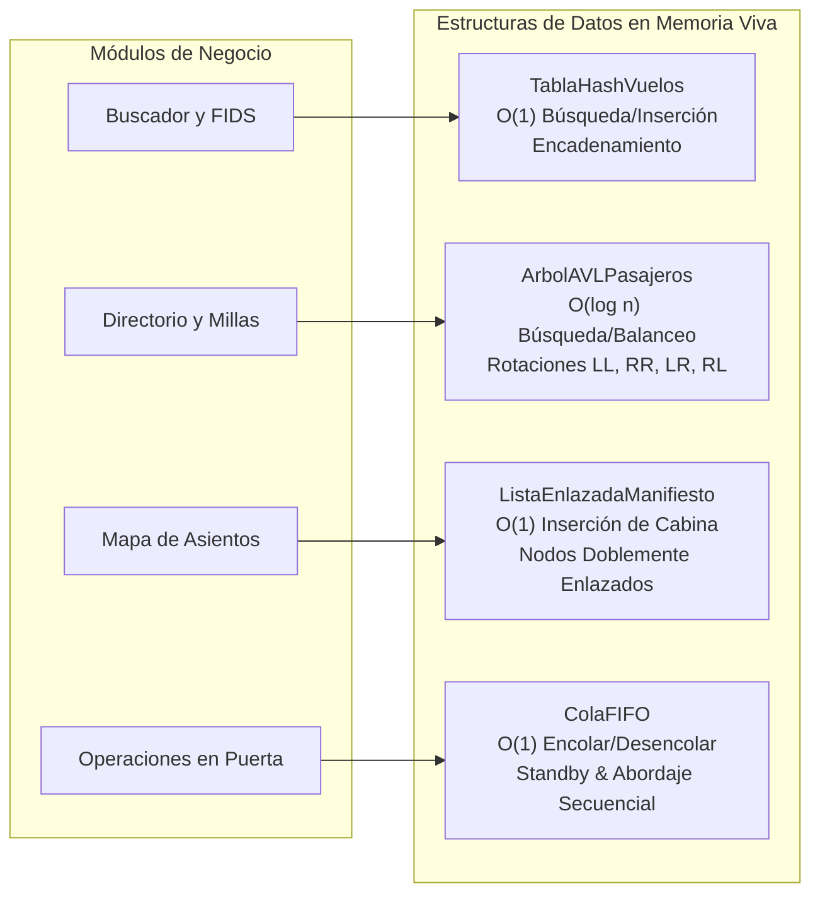
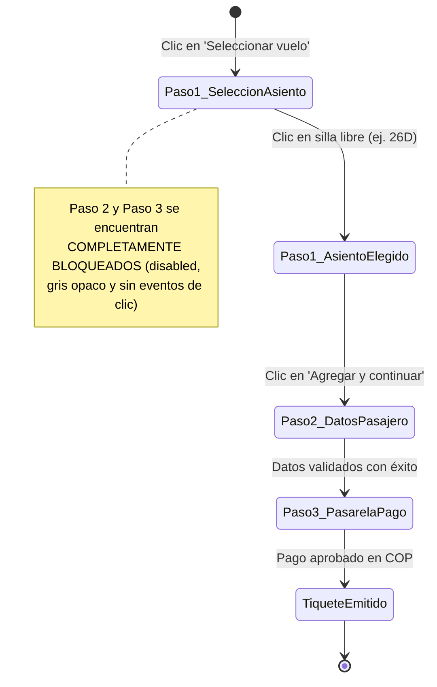
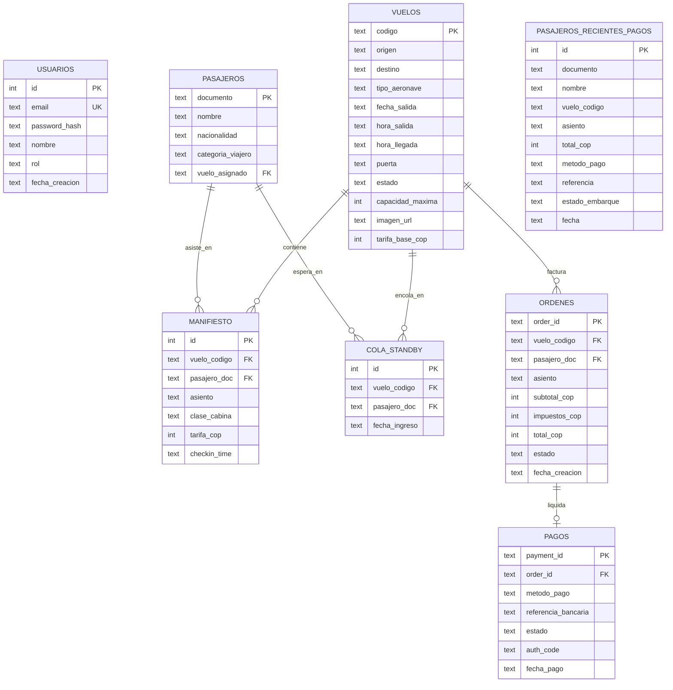
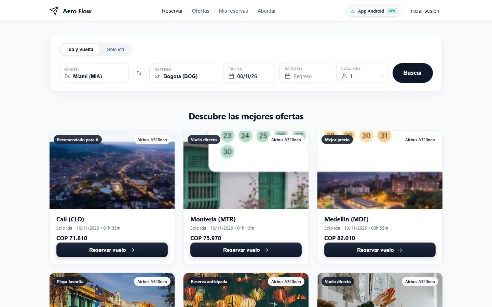
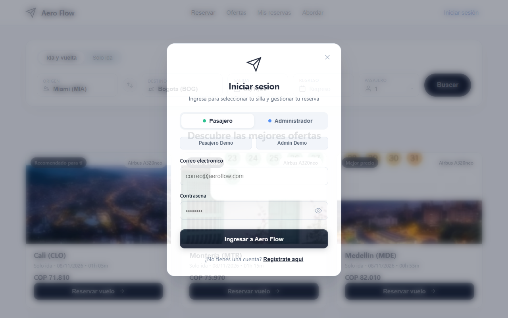
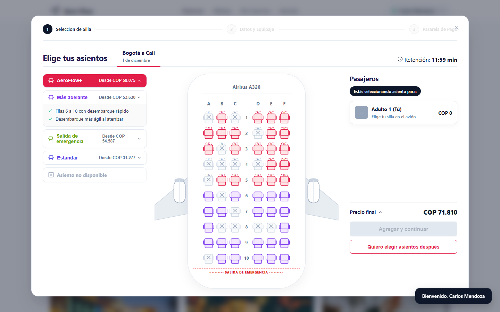
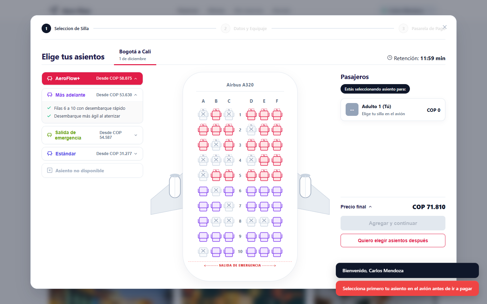
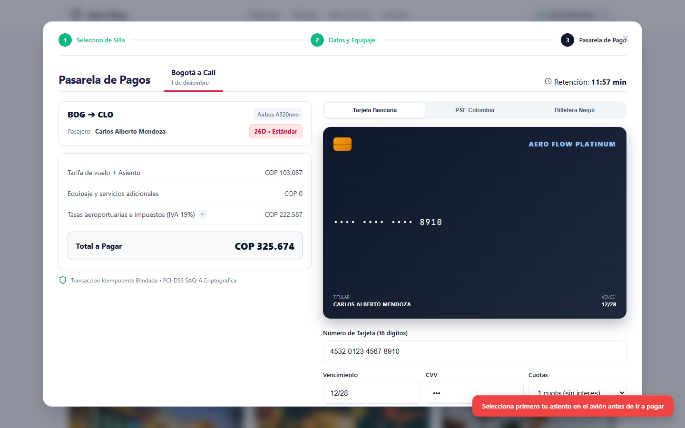
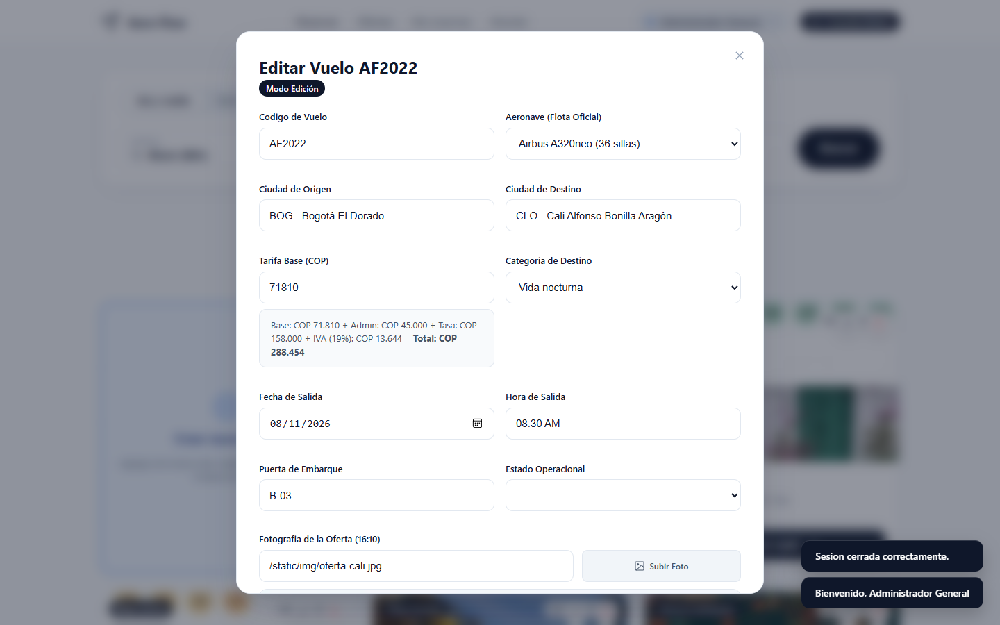

# Aero Flow Airlines — Enterprise Core Platform

Sistema empresarial de gestión comercial, reserva de asientos y control de operaciones aeroportuarias en rampa para aerolíneas comerciales de pasajeros. Diseñado con arquitectura de alto rendimiento desacoplada, indexación algorítmica en memoria viva ($O(1)$ y $O(\log n)$), persistencia relacional atómica con soporte WAL y una interfaz Single Page Application (SPA) sin dependencias de frameworks externos.

---

## 1. Título y Resumen Técnico

### Problema que resuelve
En la aviación comercial de pasajeros, las plataformas de reserva y despacho enfrentan tres desafíos computacionales críticos:
1. **Latencia en consultas de alta concurrencia:** La búsqueda de vuelos y la verificación de identidad de pasajeros sufren cuellos de botella cuando dependen exclusivamente de consultas a disco bajo picos de demanda.
2. **Condiciones de carrera y sobreventa descontrolada:** La reserva concurrente de asientos y la gestión de listas de espera (*standby*) pueden generar asignaciones duplicadas o bloqueos de concurrencia en la base de datos relacional.
3. **Flujos transaccionales inconsistentes:** La emisión de tiquetes y el procesamiento de cobros requieren validaciones estrictas por etapas (*step-gating*), garantizando que ningún usuario pase a la pasarela de pago sin un asiento reservado y validado en la cabina.

### Propósito principal y funcionamiento general
**Aero Flow Airlines** proporciona un núcleo unificado que resuelve estos problemas mediante la combinación de estructuras de datos en memoria sincronizadas bidireccionalmente con SQLite:
* **Motor comercial de pasajeros:** Búsqueda instantánea de itinerarios, mapa interactivo de fuselaje con disposición de asientos en 3 columnas estilo LATAM, acordeones colapsables de beneficios tarifarios, compuerta estricta de 3 pasos (Asiento $\rightarrow$ Pasajero $\rightarrow$ Pasarela de Pago en COP) y emisión de pases de abordar oficiales con código de barras y QR.
* **Consola de operaciones y despacho en rampa:** Gestión de estados de vuelo (`Check-in abierto`, `Embarcando`, `Última llamada`, `DESPEGADO`, `CANCELADO`), control de sobreventa mediante cola FIFO de *standby* con ascensos automáticos ante cancelaciones, abordaje individual manual (pasajero por pasajero) y secuencial con escáner láser animado y retroalimentación auditiva sintetizada mediante Web Audio API.
* **Módulo de administración de flota y contenido:** Creador y editor de vuelos con un procesador universal de imágenes (Pillow) que adapta y normaliza automáticamente cualquier fotografía de destino a una proporción 16:10 sin distorsión visual.
* **Distribución móvil:** Paquete nativo Android compilado (APK de 1.04 MB) con enlace directo de descarga desde la interfaz.

---

## 2. Stack Tecnológico

El proyecto está construido con herramientas seleccionadas para garantizar máxima velocidad, portabilidad y mínima sobrecarga de dependencias:

| Capa / Componente | Tecnología | Versión Detectada | Propósito en el Sistema |
| :--- | :--- | :--- | :--- |
| **Lenguaje Backend** | Python | `3.11.9` (Compatible con $\ge$ 3.10) | Lógica de negocio, controladores REST y algoritmos. |
| **Framework Web** | Flask | `3.1.3` | Servidor WSGI ligero para la API REST y entrega de la SPA. |
| **Seguridad y Hashing** | Werkzeug | `3.1.9` | Criptografía para contraseñas de usuarios mediante PBKDF2 / SHA-256 con salt dinámico. |
| **Procesamiento de Imágenes** | Pillow (PIL) | `12.3.0` | Normalizador y escalador universal de imágenes de destinos a relación 16:10 (`ImageOps.fit`). |
| **Motor de Base de Datos** | SQLite | `3.45.1` (Modo WAL) | Persistencia relacional atómica con `PRAGMA journal_mode=WAL;` y timeout de 30 segundos. |
| **Testing Backend** | Pytest / Unittest | `9.1.1` | Batería de pruebas automatizadas unitarias, de integración REST y de seguridad RBAC. |
| **Frontend Runtime** | Vanilla JavaScript | ES6+ Moderno | Controlador reactivo de la SPA (`app.js`, `core.js`, `minimal-ui.js`, `auth.js`) sin frameworks externos. |
| **Sistema de Diseño** | CSS3 Nativo | Estándar W3C | Variables CSS (Custom Properties), Flexbox, CSS Grid y animaciones aceleradas por GPU (`minimal-ui.css`, `design-tokens.css`). |
| **Sintetizador de Audio** | Web Audio API | Estándar W3C | Generación procedural de dobles timbres armónicos de aeropuerto (C6–G6), tonos de escáner y fanfarria. |
| **Testing E2E / UI** | Playwright | `^1.65.0` | Automatización de pruebas de navegación, flujos de registro, selección de asientos y pasarela. |
| **Empaquetado Móvil** | Capacitor / Android | `6.0` (Android SDK) | Contenedor nativo Android generando el archivo instalable `AeroFlowAirlines.apk`. |

---

## 3. Arquitectura y Estructura del Proyecto

El sistema implementa una arquitectura desacoplada donde el servidor Flask actúa como coordinador entre la memoria viva, la base de datos relacional y el cliente web estático:

```
c:\visual estudio code\avion\
├── app.py                         # Punto de entrada del servidor Flask, enrutador REST, mutex y procesador 16:10
├── config.py                      # Configuración de variables de entorno (Host, Puerto, Rutas, Debug)
├── database.py                    # Capa de persistencia SQLite (WAL, esquema, índices únicos, inicialización y CLI)
├── fleet_catalog.py               # Catálogo de modelos de aeronaves, planos de cabina y fórmulas de tarifas COP
├── validation.py                  # Validadores declarativos de entrada con expresiones regulares sanitizadas
├── airport_config.py              # Catálogo de aeropuertos de operación (BOG, MDE, MIA, MAD, etc.)
├── desktop_launcher.py            # Lanzador para entornos de escritorio / empaquetado PyInstaller
├── requirements.txt               # Especificación de dependencias de producción y pruebas en Python
├── package.json                   # Dependencias de desarrollo para Node.js y suites de Playwright
├── aerocore.db                    # Base de datos relacional SQLite (auto-generada con semilla de fábrica)
│
├── data_structures/               # Implementaciones algorítmicas nativas en memoria viva
│   ├── __init__.py                # Inicializador del paquete de estructuras de datos
│   ├── hash_map.py                # Tabla Hash O(1) con resolución de colisiones por encadenamiento
│   ├── avl_tree.py                # Árbol AVL O(log n) auto-balanceado para indexación de pasajeros por ID
│   ├── linked_list.py             # Lista Enlazada Doble para modelado dinámico del manifiesto de cabina
│   └── fifo_queue.py              # Cola FIFO estricta para sobreventa (Standby) y flujo de puerta (Boarding)
│
├── payments/                      # Adaptador modular de procesamiento de pagos
│   └── adapter.py                 # Procesador multi-método (Tarjeta de Crédito/Débito, PSE y Nequi)
│
├── templates/                     # Vistas HTML
│   └── index.html                 # Plantilla unificada Single Page Application (SPA) con semántica accesible
│
├── static/                        # Activos web estáticos servidos directamente por el backend
│   ├── apk/                       # Almacenamiento de binarios para distribución móvil
│   │   └── AeroFlowAirlines.apk   # Paquete APK oficial para Android (1.04 MB)
│   ├── css/                       # Hojas de estilo modulares
│   │   ├── design-tokens.css      # Variables de diseño (paleta de colores, tipografía, radios y sombras)
│   │   ├── minimal-ui.css         # Hoja principal del sistema de diseño (layout, asientos LATAM, modales)
│   │   ├── login.css              # Estilos del sistema de autenticación y modales de inicio de sesión
│   │   └── tactical.css           # Estilos complementarios para consola de operaciones y telemetría FIDS
│   ├── js/                        # Controladores de lógica del lado del cliente
│   │   ├── core.js                # Núcleo de utilidades (escape XSS, fetch con timeout, helpers DOM)
│   │   ├── auth.js                # Controlador de sesión, almacenamiento de token y roles (admin/pasajero)
│   │   ├── app.js                 # Controlador principal: catálogo, pasarela de pago, rampa y Web Audio
│   │   ├── minimal-ui.js          # Micro-interacciones de interfaz, navegación por pestañas y toasts
│   │   └── config.js              # Parámetros de conexión frontend hacia endpoints de API
│   └── img/                       # Recursos gráficos e imágenes subidas
│       ├── favicon.svg            # Isotipo corporativo vectorial
│       ├── oferta-*.jpg           # Fotografías maestras de destinos en alta definición
│       └── uploads/               # Directorio de fotos procesadas automáticamente a 16:10 por el admin
│
├── docs/                          # Documentación técnica y evidencias de pruebas
│   └── images/                    # Capturas de pantalla de la interfaz operativa del sistema
│       ├── 01_catalogo_y_buscador.png
│       ├── 02_autenticacion_usuarios.png
│       ├── 03_seleccion_asientos_latam.png
│       ├── 04_flujo_estricto_step_gating.png
│       ├── 05_pasarela_pago_multicanal.png
│       └── 06_panel_administracion_vuelos.png
│
├── android/                       # Proyecto nativo Android generado con Capacitor
│   └── app/src/main/              # Manifest, recursos y WebView nativo
│
└── tests/                         # Baterías de pruebas automatizadas
    ├── test_api.py                # 21 pruebas de integración REST con base de datos aislada
    ├── test_payments.py           # Pruebas del adaptador de pagos (aprobación, rechazo, idempotencia)
    ├── test_universal_image_scaler.py # Pruebas del escalador de imágenes 16:10 (resoluciones, formatos)
    ├── test_role_security.py      # Verificación de seguridad RBAC para rutas de administración
    ├── test_registration_flow.js  # Prueba E2E de registro y login de usuarios con Playwright
    └── verify_urgent_corrections.js # Prueba E2E de compuerta de pago y selector LATAM
```

---

## 4. Funcionamiento Interno y Módulos

### 4.1 Autenticación y Control de Acceso Basado en Roles (RBAC)

El sistema implementa un modelo de seguridad por roles que distingue entre usuarios estándar y administradores:
* **Mecanismo de contraseñas:** El almacenamiento de credenciales en la tabla `usuarios` utiliza la función `generate_password_hash` de Werkzeug, generando resguardos basados en PBKDF2 con SHA-256 y salt criptográfico único por registro.
* **Roles del sistema:**
  * `pasajero`: Rol por defecto asignado a nuevos registros. Permite consultar itinerarios, interactuar con el mapa de asientos, registrarse como viajero, realizar pagos en COP y consultar su pase de abordar.
  * `admin`: Rol con privilegios elevados. Habilita los botones de edición de vuelos, el botón de creación de nuevas rutas, el panel de auditoría de rampa, la cancelación manual de vuelos, la subida de fotografías procesadas y la eliminación de registros del directorio de pasajeros.
* **Controladores REST:**
  * `POST /api/auth/register`: Valida formato de correo y contraseña, verifica unicidad y persiste el usuario.
  * `POST /api/auth/login`: Comprueba el hash criptográfico y establece la sesión.
  * `GET /api/auth/me`: Retorna los datos del usuario autenticado y su rol actual.
  * `POST /api/auth/logout`: Invalida la sesión activa.

---

### 4.2 Estructuras de Datos Algorítmicas en Memoria

Para garantizar un rendimiento sub-milisegundo en las operaciones críticas, la plataforma mantiene cuatro estructuras de datos residentes en memoria viva (`data_structures/`), sincronizadas de manera bidireccional y atómica con la base de datos relacional:



#### 1. `TablaHashVuelos` (`data_structures/hash_map.py`)
* **Propósito:** Almacena la totalidad de vuelos programados para indexación instantánea por código de vuelo (ej. `AF1001`).
* **Complejidad temporal:** Búsqueda, inserción y actualización en tiempo constante amortizado **$O(1)$**.
* **Resolución de colisiones:** Encadenamiento (*chaining*) mediante nodos enlazados en cada cubeta (*bucket*). Dispone de cálculo dinámico del factor de carga ($\alpha = n / m$) y telemetría de microsegundos transcurridos por consulta.

#### 2. `ArbolAVLPasajeros` (`data_structures/avl_tree.py`)
* **Propósito:** Indexa el directorio de viajeros por su documento de identidad numérico.
* **Complejidad temporal:** Búsqueda, inserción y eliminación estrictamente garantizadas en **$O(\log n)$**.
* **Auto-balanceo:** Evalúa el factor de balanceo ($BF = \text{altura}(\text{izq}) - \text{altura}(\text{der})$) en cada mutación. Aplica rotaciones simples (Izquierda-Izquierda, Derecha-Derecha) o dobles (Izquierda-Derecha, Derecha-Izquierda) cuando $|BF| > 1$, manteniendo el árbol en equilibrio estricto.

#### 3. `ListaEnlazadaManifiesto` (`data_structures/linked_list.py`)
* **Propósito:** Modela el manifiesto de pasajeros confirmados a bordo de una aeronave en un vuelo particular.
* **Comportamiento:** Permite inserciones al final en $O(1)$, iteración secuencial para auditoría de cabina y remoción de nodos sin requerir reorganización de memoria contigua.

#### 4. `ColaFIFO` (`data_structures/fifo_queue.py`)
* **Propósito:** Administra colas estrictas de Primero en Entrar, Primero en Salir para dos casos operacionales:
  * **Cola de Standby (Sobreventa):** Cuando un vuelo alcanza el 100% de ocupación de su fuselaje, los intentos adicionales de compra no fallan sino que se encolan en espera. Si un pasajero confirmado cancela su asiento, el sistema extrae automáticamente la cabeza de la cola FIFO y promueve al viajero al asiento liberado.
  * **Cola de Abordaje:** Ordena a los pasajeros para el proceso de embarque en puerta, ordenando primero a los viajeros VIP y luego procesando a los estándar en su orden de llegada.

---

### 4.3 Flujo Estricto de Reserva y Compuerta de 3 Pasos (*Step Gating*)

Para evitar registros huérfanos o intentos de pago sin asiento confirmado, la interfaz de compra implementa una máquina de estados estricta en 3 etapas:



1. **Paso 1 — Selección de Asientos:** El usuario visualiza el fuselaje interactivo de la aeronave dividido en filas y columnas (`A-B-C / D-E-F` o `A-B / C-D`), con un panel lateral izquierdo que presenta los beneficios de clase organizados en 4 acordeones colapsables compactos. Hasta que el usuario no selecciona físicamente un asiento disponible y pulsa el botón *"Agregar y continuar"*, el Paso 2 y el Paso 3 permanecen inhabilitados.
2. **Paso 2 — Datos del Pasajero:** Se captura el documento de identidad, nombre completo y categoría del viajero. El sistema verifica que el documento no posea un tiquete activo en conflicto en otro vuelo simultáneo.
3. **Paso 3 — Pasarela de Pago Multicanal:** Se habilita la liquidación de la tarifa en Pesos Colombianos (`$ COP`) calculada con desglose fiscal (tarifa base, tasa administrativa, tasa aeroportuaria e IVA 19%).

---

### 4.4 Procesador y Escalador Universal de Imágenes 16:10

El módulo de administración (`app.py`) integra una rutina de procesamiento fotográfico basada en Pillow (`procesar_y_redimensionar_imagen_16_10`):
* **Compatibilidad de entrada:** Acepta cualquier formato estándar (JPEG, PNG, WebP, TIFF) y cualquier resolución original (incluyendo imágenes pesadas de cámaras digitales de más de 4000 px).
* **Conversión de espacio de color:** Normaliza la imagen a modo `RGB`, eliminando canales alfa o paletas indexadas que provoquen errores al renderizar en contenedores web.
* **Ajuste geométrico exacto:** Emplea `ImageOps.fit` con muestreo de alta calidad (`LANCZOS`) para recortar y ajustar la imagen a una proporción fija de **16:10** (resolución objetivo: $1280 \times 800$ píxeles).
* **Compresión optimizada:** Guarda el archivo resultante en `static/img/uploads/` en formato JPEG con compresión calibrada a calidad 85, garantizando que el peso de descarga no supere los 300 KB.

---

### 4.5 Esquema Relacional de la Base de Datos (`aerocore.db`)

La base de datos SQLite opera bajo el modo **WAL (Write-Ahead Logging)**, permitiendo múltiples lecturas concurrentes simultáneas mientras las transacciones de escritura se ejecutan de forma atómica:

```sql
PRAGMA journal_mode = WAL;
PRAGMA synchronous = NORMAL;
PRAGMA busy_timeout = 30000;
PRAGMA foreign_keys = ON;
```



#### Descripción de Tablas Principales:
1. **`usuarios`**: Directorio de cuentas del sistema. Almacena correo único, hash criptográfico de contraseña, nombre y rol (`admin` o `pasajero`).
2. **`vuelos`**: Catálogo de itinerarios operativos con origen, destino, aeronave, horarios en formato 12 horas, puerta de embarque, capacidad física, estado y tarifa en COP.
3. **`pasajeros`**: Directorio de viajeros registrados, clasificados por categoría (`VIP` o `Estándar`) y su vuelo asignado activo.
4. **`manifiesto`**: Relación atómica de ocupación física de cabina. Posee índices únicos compuestos para garantizar que ni un pasajero tenga dos asientos ni un asiento tenga dos pasajeros en el mismo vuelo:
   * `idx_manifiesto_vuelo_pasajero` en `(vuelo_codigo, pasajero_doc)`.
   * `idx_manifiesto_asiento` en `(vuelo_codigo, asiento)`.
5. **`cola_standby`**: Almacenamiento persistente de viajeros en espera cuando la cabina está al 100%. Mantiene el orden de prelación para ascensos automáticos.
6. **`ordenes`**: Encabezados de órdenes comerciales con desglose de subtotal, tasas aeroportuarias, IVA y total liquidado.
7. **`pagos`**: Transacciones financieras aprobadas o declinadas vinculadas a una orden, con método de pago (`tarjeta`, `pse`, `nequi`), referencia bancaria y código de autorización.
8. **`pasajeros_recientes_pagos`**: Bitácora operativa y financiera utilizada por el monitor de rampa para auditar el estado de embarque de cada pasajero (`Confirmado`, `EMBARCADO`, `CANCELADO`).
9. **`pago_eventos`, `reembolsos`, `recibos`, `lista_espera`**: Tablas de auditoría auxiliar para trazabilidad de cobros, notas de crédito y vouchers fiscales.

---

## 5. Capturas de Pantalla (Evidencia Visual)

Las siguientes capturas documentan el funcionamiento real de la interfaz y sus módulos:

### 5.1 Catálogo Principal y Buscador de Vuelos

*Vista del buscador de vuelos con visualización de itinerarios en formato 12 horas, selector de origen y destino, banner oficial de descarga de la aplicación móvil Android (APK) y tarjetas de destinos operados.*

---

### 5.2 Sistema de Autenticación y Control de Acceso

*Modal de inicio de sesión con soporte para roles diferenciados (`admin` y `pasajero`). Los administradores acceden a herramientas de edición de flota y subida de fotografías, mientras que los pasajeros acceden a su historial de reservas.*

---

### 5.3 Selección de Asientos en Cabina (Estilo LATAM)

*Plano cenital interactivo del fuselaje del avión en 3 columnas de asientos con indicador de estado (disponible, seleccionado, ocupado) y columna lateral con 4 acordeones colapsables compactos de beneficios tarifarios.*

---

### 5.4 Flujo Transaccional Estricto (*Step Gating*)

*Demostración de la compuerta de seguridad: los Pasos 2 ("Datos del Pasajero") y 3 ("Pasarela de Pago") se encuentran totalmente inactivos y bloqueados en color gris opaco hasta que el usuario confirma la elección de su silla.*

---

### 5.5 Pasarela de Pago Multicanal en Pesos Colombianos ($ COP)

*Etapa de pago activa con liquidación en COP y selección de método transaccional: Tarjeta de Crédito/Débito, transferencia bancaria PSE o billetera digital Nequi.*

---

### 5.6 Panel de Administración y Escalador Universal 16:10

*Formulario administrativo para edición de vuelos y carga de fotografías. El procesador interno adapta y recorta cualquier formato o resolución subida a una proporción estándar de 16:10 sin distorsión.*

---

## 6. Instalación y Ejecución Local

Sigue los pasos a continuación para desplegar el proyecto en un entorno local de desarrollo o evaluación técnica.

### 6.1 Requisitos Previos
* **Python:** Versión `3.10` o superior instalada (verificar con `python --version`).
* **Pip:** Gestor de paquetes de Python actualizado.
* **Git:** Para el clonado del repositorio.

---

### 6.2 Pasos de Despliegue

1. **Clonar el repositorio:**
   ```bash
   git clone https://github.com/nicolasmoncada160622-prog/sofware_pasajeros.git
   cd sofware_pasajeros
   ```

2. **Crear y activar un entorno virtual aislado:**
   * En **Windows (PowerShell):**
     ```powershell
     python -m venv venv
     .\venv\Scripts\Activate.ps1
     ```
   * En **Linux / macOS (Bash/Zsh):**
     ```bash
     python3 -m venv venv
     source venv/bin/activate
     ```

3. **Instalar las dependencias oficiales del sistema:**
   ```bash
   pip install -r requirements.txt
   ```

4. **Verificar o inicializar la base de datos relacional:**
   El sistema verifica automáticamente la existencia de `aerocore.db` en el primer arranque y genera los datos semilla si la base de datos se encuentra vacía. Para inicializar o diagnosticar manualmente la base de datos vía CLI:
   ```bash
   python database.py --seed-si-vacia
   ```

5. **Iniciar el servidor web:**
   ```bash
   python -X utf8 app.py
   ```
   > **Nota sobre codificación:** El parámetro `-X utf8` asegura que la consola de Windows maneje de manera limpia los caracteres tipográficos y acentos en los registros del servidor.

6. **Acceder a la aplicación:**
   Abre cualquier navegador web moderno en la dirección local:
   ```
   http://127.0.0.1:5000
   ```

---

### 6.3 Variables de Entorno Opcionales (`config.py`)

El comportamiento del servidor se puede ajustar definiendo las siguientes variables en el sistema antes de iniciar la ejecución:

| Variable | Valor por Defecto | Descripción |
| :--- | :---: | :--- |
| `AEROFLOW_HOST` | `127.0.0.1` | Dirección IP de escucha del servidor WSGI (`0.0.0.0` para acceso en red local). |
| `AEROFLOW_PORT` | `5000` | Puerto TCP en el que se atienden peticiones HTTP. |
| `AEROFLOW_DB_PATH` | `<raíz>/aerocore.db` | Ruta personalizada para el archivo de base de datos SQLite. |
| `AEROFLOW_DEBUG` | `False` | Habilita o deshabilita la recarga automática en caliente de Flask. |

*Ejemplo en PowerShell para ejecutar en un puerto alterno:*
```powershell
$env:AEROFLOW_PORT="8080"; python -X utf8 app.py
```

---

### 6.4 Ejecución de Suites de Pruebas Automatizadas

El proyecto incluye suites completas de pruebas unitarias y de integración:

* **Pruebas unitarias de estructuras de datos en memoria:**
  ```bash
  python -m unittest test_structures.py -v
  ```

* **Suite de integración REST y pruebas de endpoints (`tests/test_api.py`):**
  ```bash
  pytest tests/test_api.py -v
  ```

* **Pruebas del procesador universal de imágenes 16:10:**
  ```bash
  pytest tests/test_universal_image_scaler.py -v
  ```

* **Pruebas de la pasarela y adaptador de pagos:**
  ```bash
  pytest tests/test_payments.py -v
  ```

* **Ejecutar toda la batería de pruebas de backend en conjunto:**
  ```bash
  pytest tests/ -v
  ```
