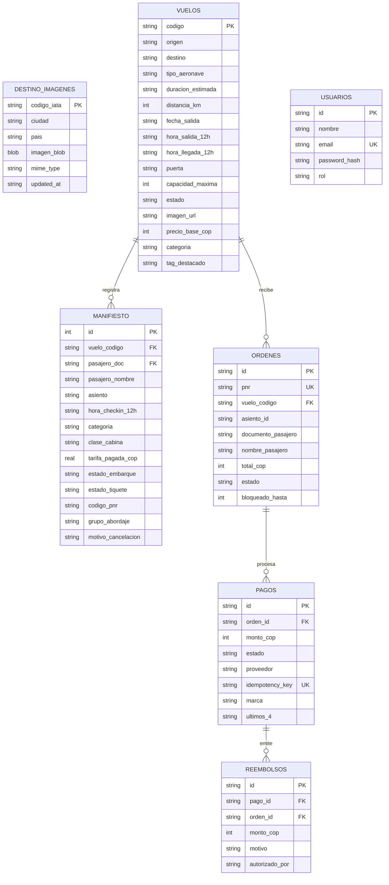
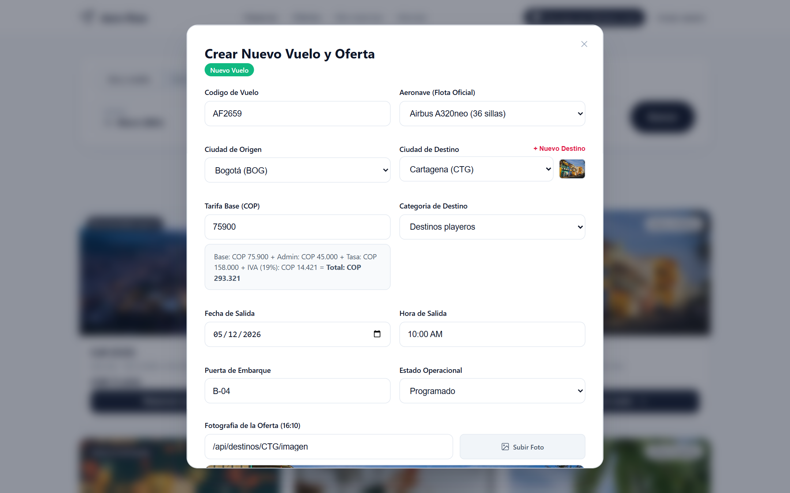
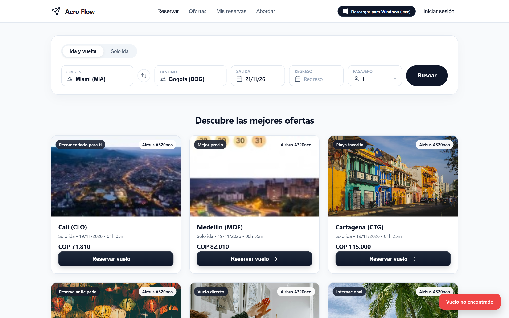
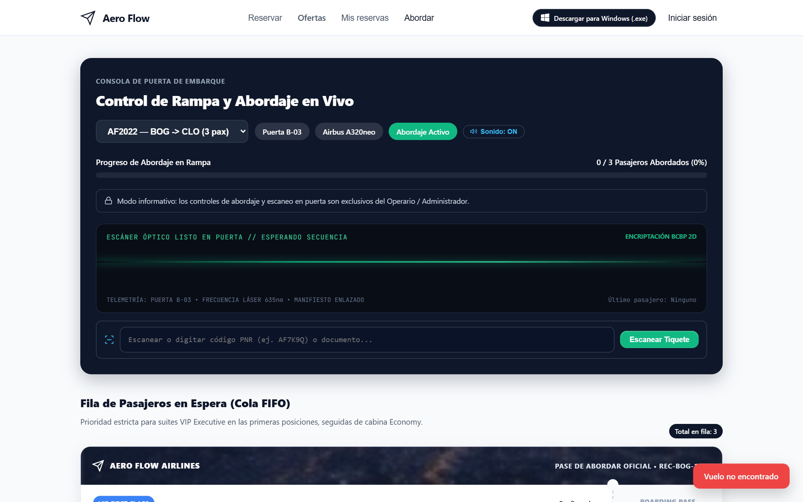
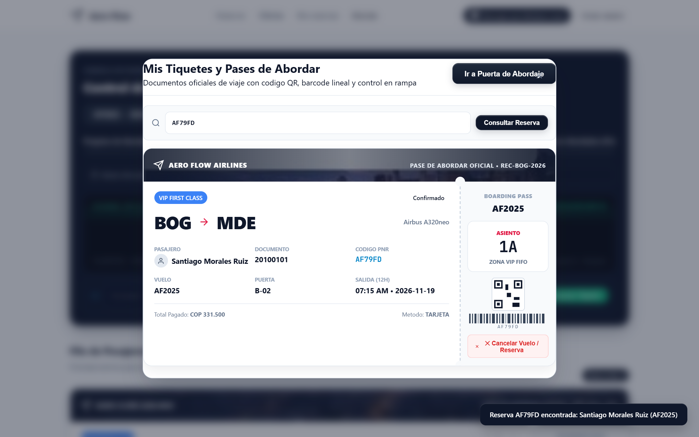

# Aero Flow Airlines — Enterprise Core Platform v3.0

Sistema empresarial de gestión comercial, itinerarios de vuelo, reserva interactiva de asientos en fuselaje, checkout multicanal blindado y control de operaciones aeroportuarias en rampa para aerolíneas comerciales. Integra persistencia relacional atómica en SQLite WAL, estructuras de datos algorítmicas en memoria ($O(1)$ y $O(\log n)$), interfaz Single Page Application (SPA) minimalista de alto rendimiento (60 FPS) y distribución ejecutable nativa para Windows (`AeroFlowAirlines.exe`).

---

## 1. Título y Resumen Técnico

### Problema que resuelve
En la industria aeronáutica comercial, las plataformas de distribución y despacho operativo enfrentan retos computacionales de misión crítica:
1. **Condiciones de carrera en asignación de asientos:** Riesgos de sobreventa (*overbooking*) o doble asignación bajo concurrencia. Aero Flow implementa bloqueos pesimistas temporizados (12 minutos) y transacciones atómicas con validación de unicidad `(vuelo_codigo, asiento)`.
2. **Latencia en consultas y colas en sala de embarque:** Cuellos de botella durante el abordaje de pasajeros en puerta. Se resuelve combinando un árbol AVL y HashMaps indexados con persistencia continua en SQLite WAL.
3. **Control estricto anti-duplicados en rampa:** El escaneo de tiquetes en puerta detecta inmediatamente dobles lecturas o intentos de reembarque, bloqueando la transacción con código de estado HTTP `409 Conflict` y alertando al operador en tiempo real.
4. **Coherencia operativa de flota y destinos:** Sincronización en tiempo real entre el catálogo de destinos con fotografías HD almacenadas como BLOBs en base de datos, el formulario administrativo de creación/edición de vuelos con desplegables dinámicos validados (`origen != destino`) y la asignación automática de aeronaves.
5. **Experiencia nativa de escritorio en PC:** Empaquetado completo en un archivo binario `.exe` autocontenido para Windows, eliminando dependencias de instalación de runtime en terminales de operaciones.

---

## 2. Stack Tecnológico

| Capa | Componente / Herramienta | Versión Detectada | Propósito Arquitectónico |
| :--- | :--- | :--- | :--- |
| **Backend & REST API** | Python / Flask | Python 3.11+ / Flask 3.1.0 | Microframework WSGI, enrutamiento REST, middleware de roles e inyección de encabezados. |
| **Servidor Concurrente** | Werkzeug WSGI Server | 3.1.3 | Manejo de peticiones HTTP/1.1 con Keep-Alive y control de concurrencia. |
| **Persistencia Relacional** | SQLite 3 (WAL Mode) | 3.45+ | Motor embebido con Write-Ahead Logging, locking transaccional y claves foráneas activas. |
| **Preprocesamiento Multimedia** | Pillow (PIL) | 11.1.0 | Recorte inteligente Lanczos centrado a relación de aspecto 16:10 (1280x800) y compresión JPEG BLOB. |
| **Empaquetado de Escritorio** | PyInstaller | 6.12.0 | Compilador de binario nativo Windows (`dist/AeroFlowAirlines.exe`, 33.51 MB). |
| **Frontend Web / UI** | HTML5 Semántico + CSS3 + Vanilla JS | ES2022+ Modern | SPA reactiva modular sin frameworks pesados, animaciones GPU 60 FPS y render interactivo. |
| **Audio Sintetizado** | Web Audio API | W3C Standard | Generación por síntesis de osciladores para campanadas de aeropuerto (chimes F5/C5) y escáner láser (1850 Hz). |
| **Testing & Calidad** | Pytest / Playwright | Pytest 9.1.1 / Playwright 1.50+ | Suites de pruebas unitarias, integración transaccional y capturas de regresión visual E2E. |

---

## 3. Arquitectura y Estructura del Proyecto

```text
avion/
├── app.py                       # Controlador REST principal, endpoints administrativos y despacho estático
├── database.py                  # Capa de persistencia SQLite WAL, migraciones automáticas y consultas SQL
├── desktop_launcher.py          # Lanzador nativo de escritorio para PC Windows (inicia servidor y abre navegador)
├── build_windows.py             # Script de automatización de compilación PyInstaller para generar AeroFlowAirlines.exe
├── AeroFlowAirlines.spec        # Especificación PyInstaller con recursos estáticos y dependencias embebidas
├── airport_config.py            # Matriz técnica de aeronaves, capacidades y distancias de rutas
├── test_structures.py           # Pruebas unitarias de algoritmos en memoria (AVL, FIFO, HashMaps)
├── aerocore.db                  # Base de datos relacional SQLite activa
│
├── dist/                        # Directorio de distribución de ejecutables de producción
│   └── AeroFlowAirlines.exe     # Binario nativo autocontenido para Windows PC (33.51 MB)
│
├── static/                      # Recursos estáticos servidos por el backend
│   ├── css/
│   │   ├── minimal-ui.css       # Sistema de diseño minimalista, 3D flip card, HUD láser y diseño responsive
│   │   ├── design-tokens.css    # Variables globales CSS (colores HSL, tipografías, sombras y transiciones)
│   │   └── tactical.css         # Utilidades de micro-interacciones táctiles y elevación
│   ├── js/
│   │   ├── minimal-ui.js        # Motor interactivo de UI (AeroMinimalUI): fuselaje, checkout 3D, consola rampa
│   │   ├── auth.js              # Controlador de autenticación de clientes y sincronización de roles
│   │   └── config.js            # Configuración de entornos y variables globales
│   └── img/                     # Logotipos vectoriales SVG y fotografías de destinos
│
├── templates/
│   └── index.html               # Plantilla SPA principal (Vistas: Explorar, Viajes, Abordar y Modales)
│
├── docs/                        # Documentación técnica y evidencia gráfica
│   └── screenshots/             # Capturas de pantalla oficiales de alta resolución
│       ├── 01_home_hero_windows.png
│       ├── 02_admin_destination_dropdown.png
│       ├── 03_seat_selection_fuselage.png
│       ├── 04_checkout_3d_card.png
│       ├── 05_boarding_console_sound.png
│       └── 06_boarding_pass_qr.png
│
├── scripts/                     # Scripts de soporte y generación de datos
│   ├── poblar_destinos_fotos.py # Seeder de paisajes HD 16:10 en SQLite (tabla destino_imagenes)
│   ├── take_screenshots.js     # Script automatizado con Playwright para capturar vistas del sistema
│   └── generate_icons.js        # Generador de favicon e iconos PWA
│
└── tests/                       # Suite automatizada de pruebas con Pytest
    ├── test_api.py              # Pruebas integrales de endpoints REST y seguridad
    ├── test_payments.py         # Pruebas de simulación de pagos, idempotencia y reembolsos
    ├── test_regression.py       # Pruebas de regresión lógica y consistencia de asientos
    ├── test_role_security.py    # Pruebas de autorización RBAC (admin vs. pasajero)
    ├── test_universal_image_scaler.py # Verificación de reescalado Lanczos 16:10
    └── test_v3_features.py      # Verificación de Windows .exe, PNR, check-in, escáner 409 y BOM Excel
```

---

## 4. Funcionamiento Interno y Módulos del Sistema

### 4.1. Motor de Persistencia y Esquema Relacional (`database.py`)
El sistema opera sobre SQLite 3 configurado con `PRAGMA journal_mode=WAL;` y `PRAGMA synchronous=NORMAL;`, lo que permite lecturas concurrentes sin bloqueo mientras se ejecutan escrituras transaccionales.



### 4.2. Desplegable Dinámico de Destinos en el Panel de Administración
- **Alimentación reactiva:** Los campos de selección de origen (`#editor-flight-origen`) y destino (`#editor-flight-destino`) se pueblan automáticamente desde `GET /api/destinos` en formato `Ciudad (IATA)` (ej. `Bogotá (BOG)`, `Cartagena (CTG)`).
- **Validación lógica:** Se impide la creación o edición de vuelos donde `origen == destino` tanto en el cliente como en el servidor (`HTTP 400 Bad Request`).
- **Enlace automático de fotografía:** Al seleccionar cualquier destino, se enlaza automáticamente su fotografía HD almacenada en la base de datos (`/api/destinos/<IATA>/imagen`), actualizando instantáneamente la miniatura de previsualización sin intervención manual.
- **Creación de destinos en caliente:** Mediante el modal **"+ Nuevo Destino"**, el administrador puede ingresar una nueva ciudad, su código IATA de 3 letras único y subir una imagen de cualquier resolución; el servidor la procesa con Pillow a 16:10 (1280x800) y la almacena en SQLite como BLOB.

### 4.3. Buscador Inteligente sin Callejones sin Salida
- **Ida y vuelta & Múltiples pasajeros:** Validación estricta `fecha_regreso >= fecha_salida`. Exige selección de $N$ asientos contiguos para $N$ pasajeros bajo un mismo PNR.
- **Fechas relativas vigentes:** Los itinerarios y ofertas se calculan de forma relativa a la fecha actual (`hoy + 2` a `hoy + 60` días), evitando fechas vencidas.
- **Fallback inteligente:** Si una ruta específica no cuenta con itinerario en la fecha exacta solicitada, el buscador lista las fechas más próximas disponibles para esa misma ruta.

### 4.4. Pasarela de Pagos con Tarjeta 3D Interactiva
- **Renderizado 3D con giro de 180°:** Diseñada con CSS `perspective: 1000px` y `transform-style: preserve-3d`. Al hacer foco (`focus`) en el campo CVV, la tarjeta gira $180^\circ$ sobre el eje Y mostrando la banda magnética y la firma de seguridad; al desenfocar (`blur`), regresa al frente.
- **Detección de franquicia en tiempo real:**
  - `^4` $\rightarrow$ Visa Signature
  - `^5[1-5]|2[2-7]` $\rightarrow$ Mastercard Black
  - `^3[47]` $\rightarrow$ American Express Platinum
- **Validación por Algoritmo de Luhn:** Verificación matemática estricta del dígito de control del número de tarjeta antes de emitir la orden.

### 4.5. Consola de Abordaje en Rampa y Audio Sintetizado
- **Detección de doble abordaje (Anti-Duplicados):** El endpoint `POST /api/embarque/escanear` valida el tiquete en la base de datos; si el pasajero ya se encuentra marcado como abordado, rechaza inmediatamente con `HTTP 409 Conflict` y activa una señal sonora de error (`160 Hz sawtooth`).
- **Web Audio API:** Generación procedural de sonido sin archivos de audio externos:
  - Campanada de bienvenida / abordaje exitoso: acorde diatónico F5 (698 Hz) seguido de C5 (523 Hz) con envolvente exponencial.
  - Confirmación de escáner láser: pulso senoidal a 1850 Hz (80 ms).
  - Fanfarria de despegue: arpegio ascendente pentatónico.
- **Interruptor de Sonido:** Botón toggle `Sonido: ON / OFF` en la consola de puerta con persistencia en `localStorage`.

### 4.6. Consulta PNR, Web Check-in y Pases de Abordar Digitales
- **Búsqueda PNR:** Campo de búsqueda rápida que consulta `/api/reservas/pnr/<PNR>` y renderiza el billete de forma inmediata.
- **Web Check-in Automatizado:** Asigna dinámicamente el grupo de abordaje según la ubicación del asiento:
  - `Grupo 1 VIP`: Cabina delantera y asientos clase VIP (Filas 1 y 2).
  - `Grupo 2 Ventana`: Asientos de ventanilla (letras A y F).
  - `Grupo 3 Pasillo`: Asientos centrales o de pasillo (letras B, C, D, E).
- **Billete Oficial de Doble Talón:** Incorpora código QR 2D encriptado BCBP, código de barras lineal e impresión limpia en PDF.
- **Cancelación Atómica:** Libera el asiento en SQLite y emite el reembolso correspondiente.

### 4.7. Seguridad de Roles (RBAC) y Exportaciones Windows Excel
- **Roles:**
  - `admin` (`admin@aeroflow.com` / `admin123`): Acceso a creación/edición/eliminación de vuelos, exportaciones CSV, panel de rampa y gestión de flota.
  - `pasajero` (`pasajero@aeroflow.com` / `pasajero123`): Consulta de itinerarios, selección de sillas, pasarela de pagos, web check-in y consulta de pases de abordar.
- **Exportación Excel CSV (BOM UTF-8):** Los reportes descargables (`/api/admin/export/ventas` y `/api/admin/export/manifiesto/<codigo>`) anteponen el Byte Order Mark `\ufeff` para que Microsoft Excel en Windows abra los caracteres especiales y acentos en español con codificación correcta.

---

## 5. Capturas de Pantalla (Evidencia Visual del Sistema)

### 5.1. Vista Principal, Buscador Inteligente y Catálogo de Destinos
Vista de inicio que destaca el botón de descarga del ejecutable para Windows (`.exe`), el buscador con fechas dinámicas relativas y las ofertas con fotografías HD cargadas desde la tabla `destino_imagenes`.


---

### 5.2. Editor Administrativo con Desplegables Dinámicos de Destino
Panel de creación y edición de vuelos en el Administrador, demostrando los menús desplegables alimentados en tiempo real desde la base de datos, la vista previa de la fotografía HD del destino seleccionado y el botón "+ Nuevo Destino".



---

### 5.3. Selector de Asientos en Fuselaje Real (Tipo LATAM)
Mapa interactivo de cabina con distribución física de asientos, pasillos, salidas de emergencia sobre las alas, suites VIP delanteras y temporizador de retención pesimista de 12 minutos.


---

### 5.4. Pasarela de Pagos con Tarjeta de Crédito 3D Interactiva
Paso 3 del flujo de checkout mostrando el desglose transparente de tarifa en pesos colombianos (COP) y la tarjeta virtual 3D con giro automático al enfocar el código CVV y validación por algoritmo de Luhn.



---

### 5.5. Consola de Puerta de Embarque y Escáner Láser en Rampa
Consola de control de rampa con telemetría en vivo, HUD de escaneo láser, selector de vuelos, barra de ocupación en tiempo real, lector manual de códigos PNR/documentos y conmutador de sonido de aeropuerto (ON/OFF).



---

### 5.6. Pase de Abordar Digital Oficial con Código QR y Código de Barras
Módulo de "Mis Reservas" con consulta instantánea por código PNR (ej. `AF79FD`), visualización del billete oficial de doble talón con fotografía del destino, asignación de grupo de abordaje y botones de acción.



---

## 6. Instalación y Ejecución Local

### Prerrequisitos
- **Sistema Operativo:** Windows 10 / 11, macOS o Linux.
- **Python:** Versión 3.10 o superior (recomendado Python 3.11).
- **Navegador Web:** Google Chrome, Microsoft Edge, Mozilla Firefox o Brave.

---

### Opción A: Ejecución Directa de la Aplicación de Escritorio (.exe en Windows)
Para terminales de despacho y usuarios en Windows que no requieren entorno de desarrollo:
1. Navega a la carpeta `dist/` del repositorio.
2. Haz doble clic sobre el archivo **`AeroFlowAirlines.exe`** (33.51 MB).
3. La aplicación iniciará automáticamente el motor backend embebido y abrirá la interfaz en el navegador predeterminado en `http://127.0.0.1:5000`.

---

### Opción B: Ejecución en Entorno de Desarrollo (Python)

#### 1. Clonar el repositorio
```bash
git clone https://github.com/nicolasmoncada160622-prog/avion.git
cd avion
```

#### 2. Crear y activar entorno virtual
En Windows (PowerShell):
```powershell
python -m venv venv
.\venv\Scripts\Activate.ps1
```

En Linux / macOS:
```bash
python3 -m venv venv
source venv/bin/activate
```

#### 3. Instalar dependencias
```bash
pip install flask pillow pyinstaller pytest
```

#### 4. Inicializar y poblar la base de datos (Opcional, se ejecuta automáticamente al arrancar)
```bash
python scripts/poblar_destinos_fotos.py
```

#### 5. Iniciar el servidor
```bash
python app.py
```

El servidor quedará disponible de inmediato en:
```text
http://127.0.0.1:5000
```

---

### Opción C: Compilar el Ejecutable `.exe` para Windows desde el Código Fuente
Para recompilar el binario nativo de Windows:
```bash
python build_windows.py
```
El script ejecutará PyInstaller con todas las dependencias estáticas empaquetadas y generará el archivo final en `dist/AeroFlowAirlines.exe`.

---

## 7. Ejecución de la Suite de Pruebas Automatizadas

El proyecto incluye 72 pruebas automatizadas que validan la integridad transaccional, estructuras algorítmicas, seguridad de roles y nuevas características operativas.

Para ejecutar la suite completa con Pytest:
```bash
pytest -v
```

Resultado esperado:
```text
============================= 72 passed in 2.47s =============================
```

Para ejecutar pruebas individuales por módulo:
```bash
pytest tests/test_v3_features.py -v     # Valida .exe, destinos en BD, PNR, check-in, 409 y BOM Excel
pytest tests/test_payments.py -v        # Valida pasarela de pagos e idempotencia
pytest tests/test_role_security.py -v   # Valida seguridad RBAC de administradores
```
