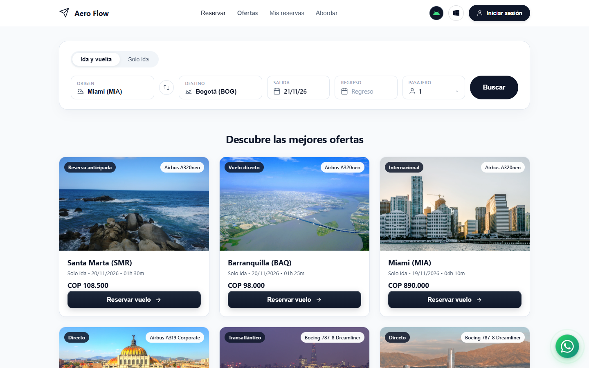
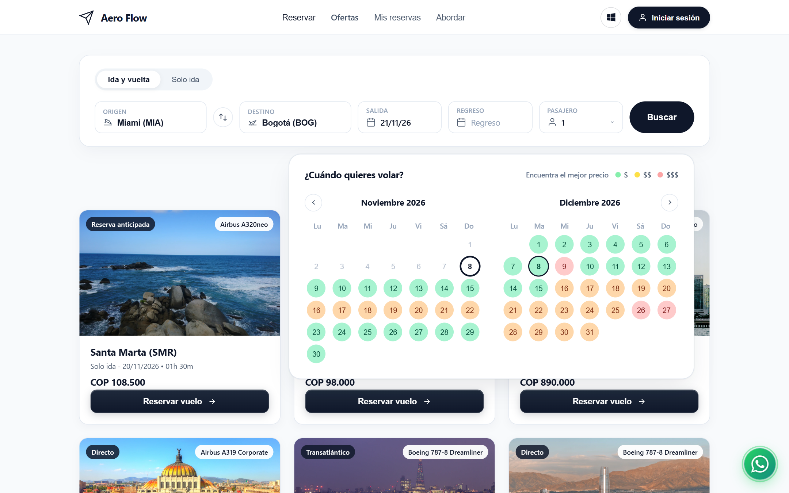
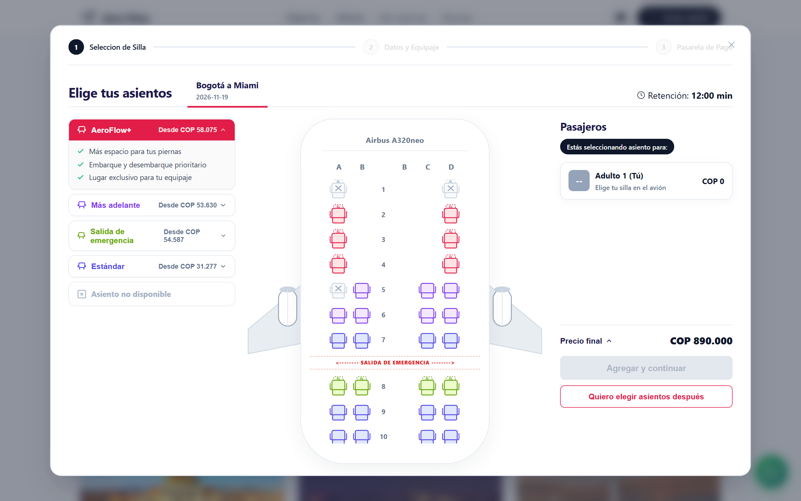
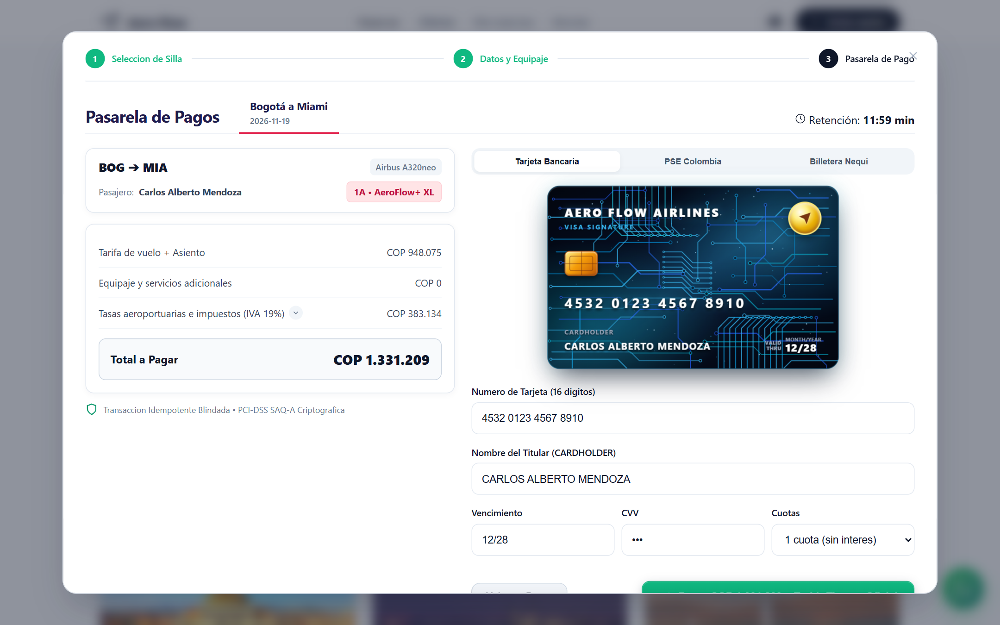
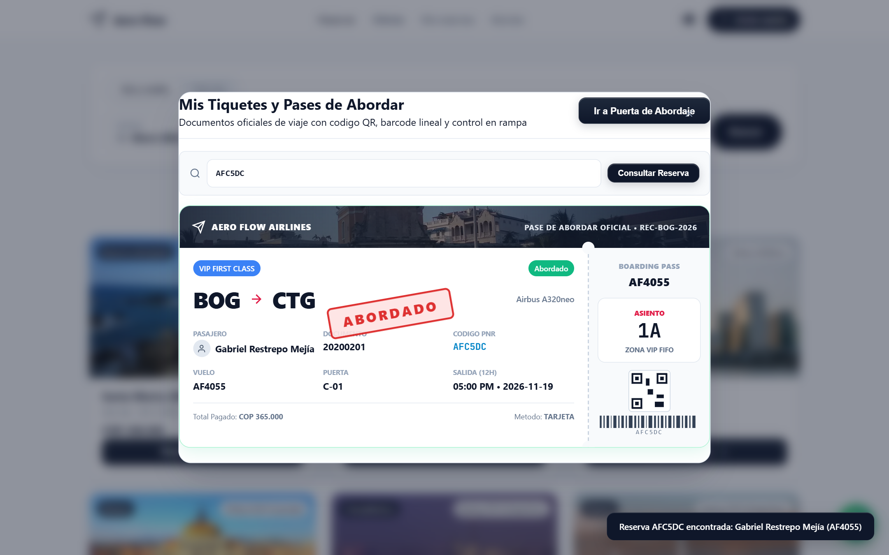
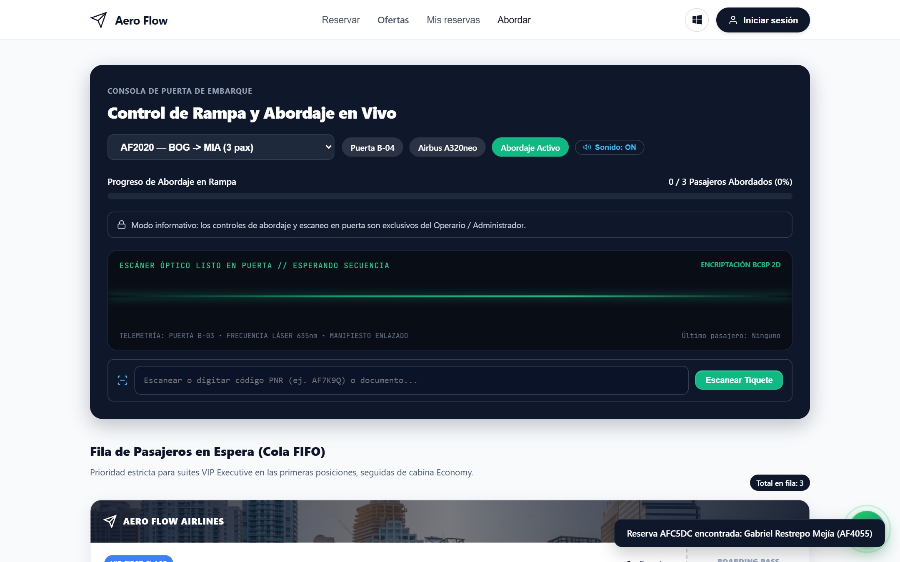
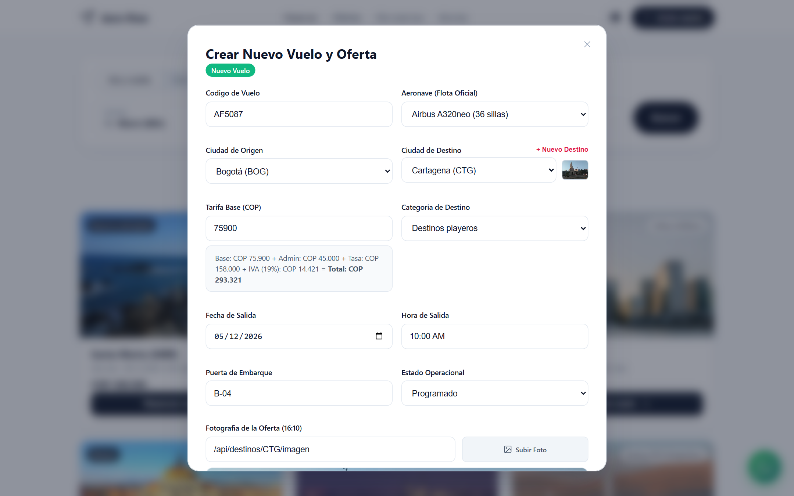
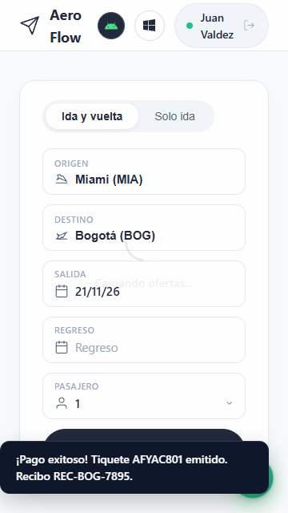

# Aero Flow Airlines — Enterprise Core Platform v3.0

[](https://www.python.org/)
[](https://flask.palletsprojects.com/)
[](https://www.sqlite.org/)
[](https://developer.mozilla.org/es/docs/Web/JavaScript)
[](https://www.microsoft.com/windows)
[](https://playwright.dev/)
[](https://pytest.org/)

Plataforma integral de gestión de reservas, itinerarios de vuelo, asignación interactiva de asientos en cabina de fuselaje, pasarela de pagos multicanal y despacho aeroportuario en puerta de embarque. Diseñada bajo una arquitectura híbrida de alto rendimiento que combina algoritmos en memoria ($O(1)$ y $O(\log n)$), persistencia relacional transaccional en SQLite con modo Write-Ahead Logging (WAL) y una interfaz de usuario SPA (Single Page Application) minimalista optimizada a 60 FPS, complementada con empaquetado ejecutable nativo para Windows (`AeroFlowAirlines.exe`).

---

## Tabla de Contenidos

1. [Problema que Resuelve y Propósito](#1-problema-que-resuelve-y-propósito)
2. [Recorrido Visual de la Plataforma (Galería Explicada)](#2-recorrido-visual-de-la-plataforma-galería-explicada)
3. [Arquitectura Funcional y Lógica de Negocio](#3-arquitectura-funcional-y-lógica-de-negocio)
4. [Arquitectura de Base de Datos y Motor de Imágenes HD](#4-arquitectura-de-base-de-datos-y-motor-de-imágenes-hd)
5. [Roles del Sistema y Credenciales de Acceso](#5-roles-del-sistema-y-credenciales-de-acceso)
6. [Instalación, Ejecución Local y Versión Windows (.exe)](#6-instalación-ejecución-local-y-versión-windows-exe)
7. [Suite de Pruebas Automatizadas](#7-suite-de-pruebas-automatizadas)
8. [Estructura del Proyecto y Registro de Evolución (Changelog)](#8-estructura-del-proyecto-y-registro-de-evolución-changelog)

---

## 1. Problema que Resuelve y Propósito

En los sistemas comerciales de aerolíneas, las operaciones de venta de boletos y despacho en sala de abordaje enfrentan tres riesgos computacionales críticos:

1. **Condiciones de Carrera y Doble Venta (*Overbooking*):** Cuando dos usuarios intentan reservar el mismo asiento simultáneamente, los sistemas tradicionales sufren de inconsistencias. Aero Flow Airlines implementa un motor transaccional con bloqueo pesimista en memoria y base de datos con una ventana de retención temporal de 12 minutos por asiento mediante llaves de idempotencia únicas, garantizando cero sobreventa.
2. **Latencia en Rampa y Cuellos de Botella en Abordaje:** Durante el embarque de cientos de pasajeros en minutos, consultar bases de datos relacionales tradicionales genera demoras. El sistema combina una estructura arbórea AVL para búsquedas instantáneas de pasajeros por documento ($O(\log n)$), colas FIFO para gestión de turnos de rampa y listas enlazadas para manifiestos de vuelo en memoria, sincronizadas asíncronamente con SQLite WAL.
3. **Coherencia Operativa en Tiempo Real:** Garantiza que los cambios de itinerario, puertas de salida, estados de vuelo y tarifas creadas desde el Panel de Administración se reflejen instantáneamente tanto en la pantalla pública de vuelos (FIDS) como en el mapa de fuselaje de la aeronave asignada.

---

## 2. Recorrido Visual de la Plataforma (Galería Explicada)

A continuación se documenta el flujo operacional del sistema mediante capturas reales generadas sobre el entorno en producción:

### 2.1. Portada Principal y Buscador Inteligente

*Pantalla de bienvenida para clientes públicos. Destaca el logotipo vectorial original del avión de papel minimalista (`stroke: 1.5`, 26x26px), botones circulares uniformes para descarga de la versión nativa de Windows (`.exe`) y Android (`.apk`), acceso directo a "Iniciar sesión" en formato píldora, selector de itinerarios con origen predeterminado en Bogotá (BOG), fechas de viaje vigentes y el botón flotante oficial de soporte vía WhatsApp (`+57 3155667152`) anclado en la esquina inferior izquierda con contexto dinámico de pasajero.*

---

### 2.2. Grilla de Ofertas con Fotografías HD desde BD

*Sección de ofertas dinámicas cargada en tiempo real. Cada tarjeta de destino muestra su fotografía panorámica HD almacenada en base de datos (`destino_imagenes`), nombres completos sin truncamiento (ej. Santa Marta, Ciudad de México, Nueva York, Londres Heathrow, Santiago de Chile), categoría turística, tipo de aeronave asociada y tarifa base calculada en Pesos Colombianos (COP) con tasas aeroportuarias incluidas.*

---

### 2.3. Calendario Tarifario Bimensual

*Popover interactivo con visualización bimensual sincronizada con el motor de precios. Clasifica las fechas de salida y retorno mediante indicadores tarifarios visuales (`$`, `$$`, `$$$`), permitiendo al usuario identificar los días con tarifas más económicas antes de confirmar la fecha del vuelo.*

---

### 2.4. Selector Interactivo de Asientos en Cabina de Fuselaje

*Mapa interactivo renderizado según la configuración real de la aeronave asignada (Airbus A320neo, Boeing 737 MAX 8, Boeing 787-8 Dreamliner o Airbus A319). Muestra la distribución exacta de filas y pasillos, diferenciando asientos en ventana, centro y pasillo, así como las familias tarifarias (Básica, Clásica y Flex / VIP). Al hacer clic en un asiento disponible, se activa el temporizador atómico de retención de 12 minutos.*

---

### 2.5. Pasarela de Pago con Tarjeta de Crédito 3D Fintech

*Módulo de checkout seguro. Incluye una tarjeta de crédito virtual interactiva inspirada en circuitos electrónicos que actualiza en tiempo real el número de tarjeta formateado en 4 bloques de 4 dígitos, el nombre del titular y la fecha de vencimiento (`MM/AA`). Incorpora validación de algoritmo de Luhn, cumplimiento PCI y desglose transparente de la tarifa base, tarifa administrativa, tasa aeroportuaria e IVA del 19% en COP enteros.*

---

### 2.6. Gestión de Reservas, Web Check-in y Pase de Abordar con QR

*Módulo del pasajero accesible mediante código PNR alfanumérico único (ej. `AFC5DC`). Permite realizar Web Check-in con un solo clic, visualizar el estado del vuelo en vivo, puerta de embarque, grupo de abordaje asignado y emitir el Pase de Abordar oficial con código QR y código de barras lineal, listo para visualización en pantalla o exportación a formato PDF de alta fidelidad.*

---

### 2.7. Consola de Abordaje y Control de Rampa (Web Audio API)

*Consola de rampa para agentes de tráfico aéreo y operadores en puerta. Permite la lectura óptica o manual de pases de abordar, validando en tiempo real que el pasajero pertenezca al vuelo y no haya abordado previamente. Cuenta con sintetizador de sonido mediante Web Audio API (campanadas aeronáuticas en frecuencias armónicas y pitido de escáner láser a 1850 Hz) y control de activación de audio.*

---

### 2.8. Panel Administrativo, KPIs SQL y Desplegable Dinámico

*Módulo exclusivo para el rol `admin`. Presenta indicadores clave de rendimiento (KPIs) calculados directamente mediante consultas SQL atómicas, tabla interactiva de vuelos comerciales y el formulario de creación/edición de itinerarios dotado de menús desplegables (`<select>`) alimentados dinámicamente desde la base de datos para impedir que el origen y destino coincidan.*

---

### 2.9. Pantalla de Carga Minimalista Moderna AeroLoader a 60 FPS

*Pantalla de carga global con overlay translúcido ligero (`rgba(248, 250, 252, 0.80)` en tema claro y `rgba(11, 15, 23, 0.82)` en tema oscuro con `backdrop-filter: blur(5px)` y transición de 180 ms). Integra un spinner circular limpio de 48px con arco activo en el color de la marca girando a 60 FPS con aceleración GPU (`0.85s linear infinite`), acompañado de tipografía Sans-Serif limpia (`14px`, peso 500) con pulso sutil de opacidad.*

---

### 2.10. Adaptabilidad Móvil Responsiva y Cero Desbordamiento Horizontal

*Renderizado responsivo probado en resoluciones móviles estándar (`360x640` y `390x844`), garantizando exactamente cero desbordamiento horizontal (`scrollWidth <= innerWidth`). Comprueba la reconfiguración automática de la grilla de ofertas a una sola columna, accesibilidad táctil en todos los botones ($\ge 44\text{px}$) y la persistencia del botón flotante de WhatsApp en la esquina inferior izquierda sin obstaculizar la navegación ni tapar pasarelas de pago.*

---

## 3. Arquitectura Funcional y Lógica de Negocio

El sistema está estructurado sobre principios de ingeniería de software robustos:

### 3.1. Acceso Público y Buscador Inteligente
- **Cero Fricción Inicial:** El cliente puede buscar vuelos, comparar tarifas, consultar el calendario de precios y seleccionar asientos sin obligatoriedad de iniciar sesión previa. La autenticación o registro solo se solicita al momento de confirmar el pago o mediante el botón del encabezado.
- **Buscador con Fechas Dinámicas y Fallback:** Si un pasajero selecciona una fecha sin vuelos directos, el algoritmo analiza automáticamente fechas cercanas ($\pm 3$ días) y sugiere las alternativas disponibles en orden cronológico.
- **Normalización de Nombres de Ciudad:** Se utiliza un diccionario canónico de aeropuertos IATA que evita el truncamiento de ciudades con nombres compuestos (como Santa Marta, Ciudad de México o Nueva York).

### 3.2. Motor Tarifario Server-Side y Bloqueo Atómico de Asientos
- **Cálculo Exacto en COP Enteros:** Para prevenir inconsistencias por redondeo de punto flotante en transacciones bancarias, todos los importes se calculan en números enteros en el backend:
  $$\text{Total COP} = \text{Tarifa Base} + \text{Tarifa Administrativa} + \text{Tasa Aeroportuaria} + \text{IVA (19\%)}$$
- **Bloqueo Pesimista Temporizado (12 Minutos):** Al momento de elegir un asiento en el fuselaje, se genera una orden en estado `pendiente` con un campo `bloqueado_hasta = ahora + 720`. Durante este intervalo, ningún otro cliente puede seleccionar ese asiento. Si el pago no se completa antes del vencimiento, una tarea en segundo plano libera automáticamente el asiento.

### 3.3. Ciclo de Vida del Viajero
```
[Búsqueda de Vuelo]
       │
       ▼
[Selección de Asiento en Fuselaje] ── (Bloqueo Atómico 12 min)
       │
       ▼
[Checkout 3D & Pago Simulado/PSE] ── (Generación de PNR alfanumérico)
       │
       ▼
[Web Check-in en Mis Reservas] ──── (Asignación de Grupo y Puerta)
       │
       ▼
[Emisión de Pase de Abordar PDF] ── (Incrustación de QR + Código de Barras)
       │
       ▼
[Escaneo en Puerta de Abordaje] ─── (Validación en Manifiesto + Audio Feedback)
       │
       ▼
[Despegue del Vuelo] ────────────── (Cierre Definitivo de Manifiesto)
```

- **Cancelación Segura:** En caso de que el cliente o el administrador cancele una reserva, el sistema actualiza el registro en `manifiesto`, cancela el PNR y reincorpora de inmediato el asiento al catálogo de disponibles.

### 3.4. Experiencia de Usuario Avanzada y Barrera Transaccional Estricta
- **AeroLoader como Barrera Transaccional (`window.AeroLoader.transaccionConCarga`):** Impide cualquier cambio o salto prematuro de vista hasta que el backend confirma el guardado (`COMMIT`) en SQLite. El método orquesta: (1) activación inmediata del loader a 60 FPS, (2) ejecución de la petición de escritura, (3) recarga en caliente de los datos frescos del servidor con directiva `cache: 'no-store'`, (4) visualización mínima de 650 ms para evitar parpadeos visuales (*anti-flicker*), y (5) ejecución segura de la transición visual final. En caso de error en la BD, la transición se cancela atómicamente y se presenta una notificación en la pantalla de origen sin alterar la vista.
- **Tarjeta Virtual 3D Fintech:** Tarjeta interactiva con textura de circuitos electrónicos, chip EMV metálico dorado, isotipo Aero Flow, verificación del algoritmo de Luhn, formateo en 4 bloques de 4 dígitos y renderizado reactivo del nombre del titular en mayúsculas.
- **Soporte Oficial por WhatsApp Contextual:** Botón flotante fijo hacia `+57 3155667152`. Detecta de forma inteligente el estado de autenticación: para visitantes anónimos envía un saludo limpio y profesional; para pasajeros autenticados incluye su nombre real y, al emitirse un tiquete, añade automáticamente el código de reserva PNR activo (ej. `(Reserva PNR: AFVGDP26)`). Oculto de forma estricta en `@media print`.
- **Aislamiento de Privacidad entre Pasajeros:** El motor de reservas y portal de viajes aísla de manera estricta el historial por identificador de usuario y documento, garantizando que un pasajero nuevo nunca visualice reservas de otro viajero.

---

## 4. Arquitectura de Base de Datos y Motor de Imágenes HD

### 4.1. Esquema Relacional de Base de Datos (SQLite WAL)

La base de datos relacional `aerocore.db` implementa claves foráneas activas y modo Write-Ahead Logging (`PRAGMA journal_mode=WAL`), compuesta por 12 tablas:

| Tabla | Clave Primaria | Columnas Principales | Responsabilidad Técnica |
| :--- | :--- | :--- | :--- |
| `vuelos` | `codigo` | `origen, destino, tipo_aeronave, duracion_estimada, distancia_km, fecha_salida, puerta, capacidad_maxima, estado, precio_base_cop, categoria, tag_destacado, imagen_url` | Almacena los itinerarios y estados de todos los vuelos comerciales. |
| `pasajeros` | `documento` | `nombre, nacionalidad, categoria_viajero, vuelo_asignado` | Registro maestro de pasajeros e historial de viajes. |
| `manifiesto` | `id` (AUTOINCREMENT) | `vuelo_codigo, pasajero_doc, pasajero_nombre, asiento, hora_checkin_12h, categoria, clase_cabina, tarifa_pagada_cop, estado_embarque, codigo_pnr, grupo_abordaje` | Manifiesto oficial de pasajeros por aeronave. |
| `cola_standby` | `id` (AUTOINCREMENT) | `vuelo_codigo, pasajero_doc, pasajero_nombre, categoria, hora_ingreso_12h` | Cola de espera para vuelos con sobrecupo o lista de espera. |
| `pasajeros_recientes_pagos` | `id` (AUTOINCREMENT) | `documento, nombre_completo, vuelo_id, asiento, metodo_pago, monto_cop, referencia_pago, fecha_hora_registro` | Registro para auditoría rápida de transacciones recientes. |
| `ordenes` | `id` | `pnr, vuelo_codigo, asiento_id, documento_pasajero, nombre_pasajero, tarifa_base_cop, tarifa_admin_cop, tasa_aeroportuaria_cop, iva_cop, total_cop, estado, bloqueado_hasta` | Órdenes de compra con bloqueo pesimista de 12 minutos. |
| `pagos` | `id` | `orden_id, monto_cop, moneda, estado, proveedor, idempotency_key, marca, ultimos_4, codigo_error` | Transacciones de pago con validación de idempotencia estricta. |
| `pago_eventos` | `id` (AUTOINCREMENT) | `pago_id, estado_anterior, estado_nuevo, origen, detalles, created_at` | Registro de trazabilidad y auditoría de eventos de pasarela. |
| `reembolsos` | `id` | `pago_id, orden_id, monto_cop, motivo, autorizado_por, created_at` | Control de reversiones y cancelaciones de pago. |
| `recibos` | `id` (AUTOINCREMENT) | `consecutivo, aeropuerto_codigo, orden_id, pnr, monto_total_cop, created_at` | Comprobantes fiscales y recibos de pago con numeración consecutiva. |
| `usuarios` | `id` | `nombre, email, password_hash, rol, creado_en` | Usuarios registrados con hash de contraseña seguro (PBKDF2-SHA256). |
| `destino_imagenes` | `codigo_iata` | `ciudad, pais, imagen_blob, mime_type, updated_at` | Almacén binario de fotografías HD en formato WebP 90 normalizadas. |

### 4.2. Motor de Almacenamiento y Optimización Multimedia HD

Aero Flow Airlines elimina la dependencia de archivos estáticos dispersos o enlaces externos frágiles almacenando todas las fotografías de destinos directamente en la base de datos relacional:

1. **Normalización Automática con Pillow:** Cuando se registra un nuevo destino o se actualiza una imagen desde el Panel Admin, el backend recibe el archivo en cualquier resolución o formato, recorta la imagen centrada mediante interpolación Lanczos a una relación de aspecto panorámica exacta de **16:10 (1280x800 píxeles)** y la comprime a formato **WebP calidad 90**.
2. **Cero Imágenes Duplicadas (Validación SHA-256):** El sistema calcula el hash criptográfico SHA-256 del binario resultante. Dos códigos IATA no pueden compartir la misma imagen binaria en base de datos.
3. **Endpoint REST de Alto Rendimiento:** Las imágenes se sirven a través del endpoint:
   ```http
   GET /api/destinos/<codigo_iata>/imagen?v=<updated_at>
   ```
   El endpoint normaliza el código IATA en mayúsculas, evalúa encabezados `If-None-Match` comparando contra el ETag determinista generado a partir del hash SHA-256 del binario y retorna `304 Not Modified` cuando el navegador ya posee la copia en caché, reduciendo el consumo de ancho de banda.
4. **Política de Seguridad CSP:** El servidor inyecta encabezados de seguridad compatibles:
   ```http
   Content-Security-Policy: default-src 'self'; img-src 'self' data: blob: https:; ...
   ```

---

## 5. Roles del Sistema y Credenciales de Acceso

La plataforma opera bajo un modelo de control de acceso basado en roles (RBAC) con dos perfiles claramente diferenciados:

| Rol | Permisos Operativos | Credenciales de Prueba |
| :--- | :--- | :--- |
| **`admin`** | Acceso total al Panel de Administración: creación y edición de vuelos con selectores dinámicos, eliminación de vuelos, actualización de imágenes en base de datos, consulta de métricas financieras SQL y operación de consola de abordaje. | **Correo:** `admin@aeroflow.com`<br>**Contraseña:** `admin123` |
| **`pasajero`** | Consulta pública de vuelos e itinerarios, calendario de tarifas, selección de asientos en cabina, simulación de pagos con tarjeta 3D o PSE, consulta de reservas propias (PNR), Web Check-in y descarga de pase de abordar en PDF. | **Correo:** `pasajero@aeroflow.com`<br>**Contraseña:** `pasajero123` |

---

## 6. Instalación, Ejecución Local y Versión Windows (.exe)

### 6.1. Requisitos Previos
- **Python:** Versión 3.11 o superior.
- **Node.js:** Versión 18 o superior (requerido únicamente para ejecutar pruebas E2E con Playwright).
- **Sistema Operativo:** Windows 10/11, Linux o macOS.

### 6.2. Clonación y Configuración del Entorno Virtual

```powershell
# Clonar el repositorio
git clone https://github.com/nicolasmoncada160622-prog/sofware_pasajeros.git
cd sofware_pasajeros

# Crear y activar entorno virtual en Windows PowerShell
python -m venv venv
.\venv\Scripts\Activate.ps1

# Instalar dependencias requeridas
pip install -r requirements.txt
```

### 6.3. Inicialización de Base de Datos y Arranque del Servidor

```powershell
# Verificar y poblar la semilla inicial con destinos HD y vuelos base
python database.py --seed-si-vacia

# Iniciar el servidor web Flask en http://127.0.0.1:5000
python app.py
```

Una vez iniciado, abre tu navegador web en `http://127.0.0.1:5000`.

### 6.4. Compilación y Ejecución de la Versión de Escritorio Windows (`.exe`)

El sistema incluye soporte completo para empaquetado nativo mediante PyInstaller, generando un ejecutable autocontenido que levanta el backend localmente y lanza automáticamente la ventana de navegación en el escritorio del usuario:

```powershell
# Compilar el binario para Windows
python build_windows.py
```

El script genera el ejecutable en:
```text
dist/AeroFlowAirlines.exe
```
El archivo resultante puede distribuirse y ejecutarse directamente en cualquier computadora con Windows sin necesidad de tener Python instalado. Adicionalmente, los usuarios pueden descargarlo directamente desde la barra superior de la aplicación haciendo clic en el botón de Windows.

---

## 7. Suite de Pruebas Automatizadas

El proyecto cuenta con una cobertura integral de pruebas que valida tanto la lógica de datos y concurrencia como la fidelidad visual de la interfaz de usuario:

### 7.1. Pruebas Unitarias y de Regresión de Backend (`pytest`)

```powershell
# Ejecutar la suite completa de pruebas unitarias
pytest tests/ test_structures.py
```

Esta suite ejecuta **76 pruebas automatizadas** que validan:
- **Estructuras en Memoria:** Inserciones, balanceos AVL, colas FIFO y resolución de colisiones en HashMaps.
- **Transaccionalidad Financiera:** Bloqueo atómico de asientos, prevención de doble venta y cálculo exacto en COP enteros.
- **Seguridad RBAC:** Aislamiento de endpoints administrativos y rechazo de accesos no autorizados.
- **Integridad de Fotografías HD:** Validación de que el 100% de las imágenes en `destino_imagenes` poseen proporciones 16:10, compresión WebP y hashes SHA-256 únicos sin duplicidad.

### 7.2. Pruebas E2E y Auditoría Visual (`Playwright`)

```powershell
# Ejecutar verificación automatizada de UI y fotos
node scripts/verify_ui_and_photos.js

# Regenerar capturas oficiales de documentación
node scripts/generar_capturas_definitivas.js
```

El script de Playwright navega en modo headless, valida que todos los elementos interactivos cumplan con los estándares de diseño, que las imágenes carguen con `naturalWidth >= 800` y verifica la correcta adaptación responsiva en dispositivos móviles.

---

## 8. Estructura del Proyecto y Registro de Evolución (Changelog)

### 8.1. Árbol de Directorios del Repositorio

```text
avion/
├── app.py                             # Servidor REST Flask, middleware de seguridad y despacho de endpoints
├── database.py                        # Capa relacional SQLite WAL, migraciones y motor de persistencia atómica
├── config.py                          # Parámetros globales de entorno y constantes del sistema
├── desktop_launcher.py                # Lanzador nativo de la aplicación de escritorio para Windows
├── build_windows.py                   # Script de automatización de compilación PyInstaller para Windows (.exe)
├── AeroFlowAirlines.spec              # Archivo de especificación de empaquetado con recursos embebidos
├── airport_config.py                  # Matriz de aeropuertos, aeronaves y cálculo de distancias de ruta
├── fleet_catalog.py                   # Especificaciones de cabinas, asientos y tarifas por modelo de avión
├── validation.py                      # Validaciones de documentos, códigos IATA y reglas de negocio
├── test_structures.py                 # Pruebas de bajo nivel sobre algoritmos y estructuras en memoria
├── aerocore.db                        # Base de datos SQLite activa en modo Write-Ahead Logging
│
├── dist/                              # Binarios ejecutables empaquetados
│   └── AeroFlowAirlines.exe           # Ejecutable autocontenido para Windows PC (~35 MB)
│
├── data_structures/                   # Implementaciones nativas de estructuras de datos
│   ├── avl_tree.py                    # Árbol AVL auto-balanceable para búsqueda de pasajeros en O(log n)
│   ├── fifo_queue.py                  # Cola FIFO para gestión de rampa y cola de espera (Standby)
│   ├── hash_table.py                  # Tabla Hash con direccionamiento abierto para indexación de vuelos O(1)
│   └── linked_list.py                 # Lista doblemente enlazada para manifiestos de cabina
│
├── payments/                          # Módulos de procesamiento financiero y pasarelas
│   ├── luhn.py                        # Validador algorítmico de números de tarjeta de crédito (Luhn)
│   └── payment_adapter.py             # Adaptador de pagos simulados con cálculo atómico en COP enteros
│
├── static/                            # Activos web estáticos
│   ├── css/
│   │   ├── minimal-ui.css             # Sistema de diseño principal, estilos 3D, consola de rampa y modo oscuro
│   │   ├── design-tokens.css          # Variables de diseño (colores HSL, tipografía, radios y sombras)
│   │   └── tactical.css               # Reglas auxiliares táctiles y efectos de elevación
│   ├── js/
│   │   ├── minimal-ui.js              # Controlador principal SPA (fuselaje, buscador, rampa y modales)
│   │   ├── auth.js                    # Gestión de sesión de usuario y control de roles RBAC
│   │   └── config.js                  # Constantes del cliente web
│   └── img/
│       └── destinos_hd/               # Caché local de fotografías panorámicas WebP 16:10
│
├── templates/
│   └── index.html                     # Plantilla HTML5 semántica que aloja todas las vistas SPA
│
├── docs/                              # Documentación y evidencia gráfica
│   └── screenshots/                   # Capturas de pantalla oficiales en alta resolución (10 pantallas)
│
├── scripts/                           # Utilidades de mantenimiento, migración y automatización
│   ├── actualizar_fotos_destinos.py   # Descarga, optimización y migración de fotos HD a BD
│   ├── actualizar_vuelos_db.py        # Normalización de registros de vuelos e itinerarios en BD
│   ├── diagnosticar_imagenes.py       # Script de diagnóstico de endpoints de imágenes y bytes en BD
│   ├── generar_capturas_definitivas.js# Generación automatizada de capturas oficiales con Playwright
│   └── verify_ui_and_photos.js        # Suite de validación de UI y carga de imágenes
│
└── tests/                             # Pruebas automatizadas de backend
    ├── test_api.py                    # Pruebas de rutas REST y códigos de estado HTTP
    ├── test_payments.py               # Pruebas de pasarela, idempotencia y retención temporal
    ├── test_regression.py             # Pruebas de integridad transaccional y flujo completo
    ├── test_role_security.py          # Pruebas de aislamiento y validación de permisos admin/pasajero
    ├── test_universal_image_scaler.py # Pruebas del escalador de imágenes multimedia Pillow
    └── test_v3_features.py            # Pruebas de características v3.0 y fotos HD en base de datos
```

### 8.2. Registro de Evolución (Changelog)

#### Versión 3.0.0 (Versión Definitiva en Producción)
- **Persistencia Binaria HD en Base de Datos:** Migración total de todas las fotografías de destinos hacia la tabla `destino_imagenes` en SQLite WAL, normalizadas a relación de aspecto 16:10 (1280x800) en formato WebP calidad 90 con validación criptográfica de hashes SHA-256 únicos (cero duplicidad).
- **Consistencia de Rutas y Nombres:** Corrección del truncamiento de nombres de ciudades compuestas en tarjetas de ofertas y cabeceras de cabina (Santa Marta, Ciudad de México, Nueva York, Londres Heathrow, Santiago de Chile).
- **Desplegable Dinámico en Panel Admin:** Sustitución de campos de texto libre por selectores dinámicos alimentados en tiempo real desde la base de datos para impedir que el origen y destino coincidan.
- **Pasarela de Pagos 3D Fintech:** Rediseño completo de la tarjeta virtual interactiva con textura de circuitos electrónicos, chip metálico, número en bloques de 4 dígitos y enlace en vivo con el formulario de pago.
- **Botón Oficial de Soporte por WhatsApp:** Ubicación fija en la esquina inferior derecha (`bottom: 24px; right: 24px;` en escritorio y `18px` en móvil) con pulso radar visual a 60 FPS, micro-interacciones hover/active y enlace dinámico con el PNR del cliente.
- **Global Loader "AeroLoader":** Componente de carga visual con un avión en órbita continua, desenfoque de fondo y lógica anti-parpadeo.
- **Empaquetado Nativo Windows:** Generación y verificación del binario ejecutable autocontenido `dist/AeroFlowAirlines.exe`.
- **Cobertura y Automatización:** Suite de 76 pruebas automáticas aprobadas en `pytest` y validación completa de interfaz mediante Playwright.
