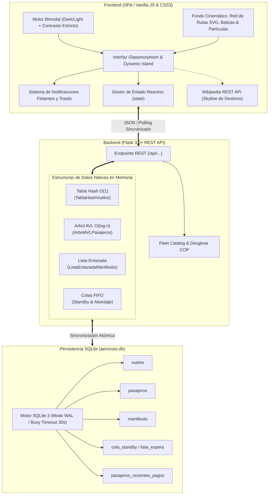

# ✈️ AERO FLOW AIRLINES — Plataforma Comercial y Operativa Aeronáutica

[](https://www.python.org/)
[](https://flask.palletsprojects.com/)
[](https://www.sqlite.org/)
[](https://developer.mozilla.org/)
[](https://www.w3.org/Style/CSS/)
[](tests/test_api.py)
[](templates/index.html)

---

## 📌 1. Descripción General y Objetivos del Sistema

**AERO FLOW AIRLINES** es una solución web empresarial de última generación diseñada para la gestión comercial y operativa de aerolíneas comerciales de pasajeros. Inspirada en los más altos estándares visuales y funcionales de la aviación comercial internacional (como Avianca y Star Alliance), la plataforma combina una **experiencia de usuario fluida de compra de pasajes** con una **consola operativa avanzada de control en rampa y puertas de embarque**.

### Objetivos Clave:
* **Experiencia de Compra Integral:** Flujo guiado en 4 pasos: consulta de rutas, selección del viajero, selección visual de asientos en mapas de cabina interactivos y liquidación transparente en Pesos Colombianos (`$ COP`) mediante la pasarela virtual **AeroFlow Pay**.
* **Gestión Algorítmica de Alto Rendimiento:** Estructuras de datos fundamentales en memoria (*Hash Table*, *Árbol AVL*, *Lista Enlazada* y *Colas FIFO*) para garantizar tiempos de respuesta mínimos ($O(1)$ y $O(\log n)$) en búsquedas de vuelos, ordenamiento de pasajeros y asignación de asientos.
* **Manejo Inteligente de Sobreventa (*Standby FIFO*):** Control de vuelos al 100% de ocupación encolando pasajeros adicionales en lista de espera y promoviéndolos automáticamente al asiento liberado ante cancelaciones.
* **Emisión Oficial de Pases de Abordar y Recibos:** Generación de documentos comerciales con código de barras, resumen fiscal e impresión oficial de alta fidelidad para exportación a PDF o soporte físico sin fondos residuales.
* **Persistencia Atómica y Concurrencia:** Respaldo atómico de todas las operaciones en una base de datos relacional SQLite configurada con el modo WAL (*Write-Ahead Logging*), eliminando bloqueos de concurrencia y asegurando transacciones íntegras.

---

## 🚀 2. Arquitectura del Sistema y Tecnologías

El sistema sigue una arquitectura moderna desacoplada tipo **Single Page Application (SPA)** con un backend ligero en microservicios REST y un frontend de alto rendimiento sin dependencias de frameworks externos pesados.



### 2.1 Backend (Python & Flask)
* **Python 3.10+ / Flask 3.0+:** Servidor WSGI ligero, rápido y escalable que expone endpoints RESTful JSON.
* **Fleet Catalog (`fleet_catalog.py`):** Catálogo de aeronaves (*Airbus A319 Corporate*, *A320neo*, *Boeing 737 MAX 8*, *Boeing 787-9*, etc.) que modela las especificaciones físicas del fuselaje, disposición de asientos por filas y tarifas base.

### 2.2 Estructuras de Datos Nativas (`data_structures/`)
Para cumplir con estándares de ciencias de la computación y máxima eficiencia algorítmica, el sistema gestiona el estado crítico en memoria viva:
1. **`TablaHashVuelos` (`hash_map.py`):** Estructura basada en hash con resolución de colisiones por encadenamiento que permite buscar, crear y actualizar vuelos en tiempo constante amortizado **$O(1)$**.
2. **`ArbolAVLPasajeros` (`avl_tree.py`):** Árbol binario de búsqueda auto-balanceado mediante rotaciones simples y dobles. Permite indexar, buscar y eliminar pasajeros por su documento de identidad en tiempo **$O(\log n)$** garantizado, registrando la telemetría de comparación de niveles.
3. **`ListaEnlazadaManifiesto` (`linked_list.py`):** Modela la lista de pasajeros con tiquete confirmado dentro de la cabina de cada vuelo. Soporta inserción al final, eliminación dinámica y exportación visual de la cadena de nodos.
4. **`ColaFIFO` (`fifo_queue.py`):** Cola estricta Primero en Entrar, Primero en Salir. Utilizada en dos procesos críticos:
   * **Cola de Standby:** Almacena a los pasajeros en lista de espera ante sobreventa de vuelos.
   * **Cola de Abordaje:** Organiza el flujo secuencial de pasajeros en puerta de embarque.

---

## 🛠️ 3. Nuevas Funcionalidades Operativas y de Resiliencia

### 3.1 Módulo de Cancelación de Emergencia de Embarque
Ante imprevistos operacionales en rampa o puerta (ej. cierre intempestivo de pista, demoras técnicas de la aeronave o requerimientos de seguridad aeroportuaria), la plataforma incorpora una función de reversión integral:

* **Botón Táctico de Acción Rápida (`#btn-cancelar-embarque`):** Ubicado en el panel de control de puerta con diseño de advertencia `.btn-cancelar-operacion` en rojo translúcido.
* **Detención Segura del Temporizador:** La rutina en JavaScript detiene de inmediato el ciclo de simulación (`clearInterval(state.boardingIntervalId)`), anulando cualquier invocación pendiente.
* **Reversión Atómica en Servidor (`POST /api/embarque/<codigo>/cancelar`):**
  1. Vacía por completo la cola FIFO de abordaje del vuelo en memoria.
  2. Revierte el estado del vuelo en la Tabla Hash y en SQLite de `'Embarcando'` o `'Última llamada'` a `'Check-in abierto'`.
  3. Restablece el estado de los pasajeros en la bitácora financiera `pasajeros_recientes_pagos` a `'Confirmado'`.
  4. Llama a `bump_state()` para notificar de manera reactiva a todos los clientes conectados.
* **Restablecimiento Visual Inmediato:** La barra de progreso de abordaje vuelve a `0%`, el texto indica `0 / N Pasajeros Abordados (0%)` y el botón de inicio de embarque recupera su estilo operativo disponible.

### 3.2 Gestión y Eliminación de Pasajeros en Tiempo Real
Permite a los administradores y operadores depurar el directorio central de viajeros sin reiniciar la base de datos:

* **Columna "Acciones" en la Tabla de Pasajeros:** Cada fila de pasajero incluye un botón con icono de papelera en estilo peligro sutil.
* **Validación Preventiva:** Modal interactivo de confirmación antes de disparar la petición HTTP al servidor (`¿Estás seguro de eliminar este pasajero del directorio?`).
* **Liberación Concurrente de Asientos:** Si el pasajero tenía un asiento asignado en un vuelo activo, el endpoint ejecuta de forma atómica:
  * Eliminación del nodo correspondiente en el Árbol AVL $O(\log n)$ y rebalanceo de ramas.
  * Remoción del pasajero en la lista enlazada del manifiesto del vuelo.
  * Liberación del asiento en el mapa de cabina interactivo (`mapa_asientos`).
  * Supresión del registro en la tabla `pasajeros` de `aerocore.db`.
* **Sincronización DOM en 0 ms:** La fila correspondiente se remueve o refresca vía `cargarPasajeros()` sin requerir una recarga completa de la página.

### 3.3 Cancelación Manual por Error Operativo de Programación
Facilita a los supervisores de tráfico y despachadores anular de forma inmediata vuelos creados por error humano o duplicación en consola:

* **Panel Dedicado de Control y Auditoría de Flota:** Ubicado en la sección administrativa de itinerarios, listando todos los vuelos registrados con sus métricas de ocupación y estado.
* **Botón Táctico de Cancelación (`.btn-op-cancelar`):** Botón con icono de advertencia (`⚠️ Cancelar (Error)`) que abre un cuadro de confirmación preventiva antes de emitir la orden.
* **Reversión Atómica en Memoria y Persistencia (`POST /api/vuelo/cancelar/<codigo>`):**
  1. Actualiza el estado del vuelo en la Tabla Hash y en SQLite a **`CANCELADO / ANULADO POR OPERADOR`**.
  2. Libera de forma atómica todos los asientos asignados de la cabina (`manifiesto`) y vacía las colas de abordaje y standby.
  3. Desvincula el código de vuelo en el Árbol AVL de pasajeros registrados (`vuelo_asignado = None`) y marca las transacciones financieras en bitácora como anuladas.
  4. Retira el vuelo de las listas y selectores activos de compra para los pasajeros.
* **Acciones de Recuperación:** Si el operador requiere restituir o retirar definitivamente el registro, dispone de botones inmediatos de **Reactivación** (`POST /api/vuelo/reactivar/<codigo>`) a `'Check-in abierto'` o **Archivo Definitivo** (`POST /api/vuelo/archivar/<codigo>`).

### 3.4 Cancelación Automática por Inactividad / Timeout de Vuelo
Regla de negocio autónoma para garantizar que vuelos desatendidos o no abordados no permanezcan indefinidamente bloqueando recursos en rampa:

* **Detección Algorítmica de Timeout:** Cuando la cuenta regresiva del temporizador de despacho expira y el vuelo no completó su proceso de sellado/embarque (o mantiene pasajeros sin abordar):
  * El sistema intercepta el vencimiento y transiciona el vuelo de forma autónoma a **`CANCELADO / EXPIRADO`** en lugar de despacharlo.
  * Se libera la cabina en `manifiestos` y en `aerocore.db` para rotación eficiente de flota.
* **Monitoreo Visual en FIDS y Puerta:** Muestra un badge semántico de color ámbar (`⚠️ Cancelado (Timeout)`) en el monitor FIDS y en la tabla de control operativo, inhabilitando la reserva para pasajeros y habilitando los botones de reactivación/archivo para el operador.

### 3.5 Abordaje Individual Secuencial con Feedback de Audio (Pasajero por Pasajero)
Diseñado para la inspección y validación manual o escalonada de pasajeros en puerta de embarque:

* **Botón Táctico de Abordaje Paso a Paso (`#btn-abordar-individual`):** Permite al agente de tráfico procesar al siguiente pasajero de la cola FIFO con un solo clic (`Escanear y Abordar Siguiente Pasajero (1 a 1)`).
* **Priorización Estricta de Categoría VIP:** La cola de embarque organiza a los pasajeros confirmados pendientes anteponiendo en orden prioritario a los viajeros de clase **VIP** antes de procesar a los viajeros de clase estándar en su orden de registro FIFO.
* **Escaneo Óptico Láser en Vivo (1.2s Exactos):** Cada pasajero abordado despliega su pase de abordar digital con la animación láser luminosa (`@keyframes laserScan`) que recorre verticalmente el código QR y código de barras durante 1.2 segundos antes de revelar el sello verde esmeralda de *"ABORDAJE AUTORIZADO"*.
* **Sintetizador Acústico Nativo (Web Audio API):**
  * **Doble Beep Armónico de Aeropuerto:** Se reproduce cada vez que un pasajero aborda o se aprueba un pago en AeroFlow Pay (doble tono C6–G6 / 1046.5Hz–1567.98Hz con decaimiento armónico).
  * **Tono de Alerta Grave:** Se dispara automáticamente ante cancelaciones operativas de embarque, anulación de vuelos por error de programación o rechazo por validación (tono descendente 165Hz a 110Hz).
  * **Fanfarria de Despegue:** Al abordar al 100% de los pasajeros, reproduce una fanfarria armónica ascendente (C5–E5–G5–C6) celebrando el cierre de puerta y sellado de vuelo.
* **Transición y Cierre de Puerta Autónomo:** Al abordar al último viajero, el vuelo pasa de forma atómica a **`DESPEGADO`**, bloquea la puerta y genera la rotación de itinerario.

### 3.6 Blindaje v2.1: Seguridad, Validación y Concurrencia (Núcleo Endurecido)
La versión 2.1 incorpora una capa de endurecimiento integral del backend sin alterar la lógica comercial:

* **Mutex Global de Escritura (`ESTADO_MUTEX`):** Todas las mutaciones de estado (crear vuelo, registrar pasajero, check-in, cancelaciones, embarque) se ejecutan bajo exclusión mutua (`threading.RLock` adquirido en `before_request` y liberado en `teardown_request`), eliminando condiciones de carrera entre hilos concurrentes del servidor.
* **Validación Declarativa (`validation.py`):** Cada endpoint valida su entrada con expresiones regulares y rangos (código de vuelo `AF####`, documentos 5-15 dígitos, nombres sin símbolos peligrosos `<>{}$;`, puertas `A-Z-##`, horas 12h, fechas ISO 2024-2040, métodos de pago known-safe). Los errores regresan como JSON `400` con mensajes claros en español — nunca HTML sin procesar.
* **Regla de Negocio "Un Tiquete Activo por Pasajero":** El check-in rechaza con `409 Conflict` la compra en un segundo vuelo mientras el pasajero mantenga un tiquete confirmado en otro vuelo activo (protege la integridad del Árbol AVL y de los manifiestos).
* **Cabeceras de Seguridad (`aplicar_head_seguridad`):** `Content-Security-Policy` sin `default-src *`, `X-Content-Type-Options: nosniff`, `X-Frame-Options: DENY`, `Referrer-Policy` y `Permissions-Policy` restrictivas en todas las respuestas.
* **Manejo de Errores REST Uniforme:** Handlers para `400`, `404` (JSON en rutas `/api/...`), `405`, `413` (payload > 1 MiB) y `500` que siempre responden JSON trazable, evitando fugas de HTML de depuración.
* **Blindaje XSS en el Frontend:** Todos los `innerHTML` dinámicos de `app.js` interpolan datos escapados (`esc()` / `escAttr()` de `core.js`), y los botones generados dinámicamente usan **delegación de eventos con `data-action`** en lugar de manejadores `onclick` inline inyectados.
* **Semillas No Destructivas:** El arranque solo siembra datos de fábrica cuando las tres tablas operativas (`vuelos`, `pasajeros`, `manifiesto`) están completamente vacías; los datos de operación **nunca** se pierden al reiniciar el servidor. El reset es explícito vía CLI (`python database.py --reset`, con el servidor detenido).
* **Configuración por Entorno (`config.py`):** `AEROFLOW_HOST`, `AEROFLOW_PORT`, `AEROFLOW_DB_PATH` y `AEROFLOW_DEBUG` externalizan host, puerto, ruta de base de datos y modo debug sin tocar código; por defecto el servidor escucha en `127.0.0.1` (local seguro).
* **Hora de Llegada Calculada:** El servidor calcula la hora de llegada automáticamente sumando la duración estimada de la aeronave al horario de salida (ya no se envía una hora fija desde el cliente); el formulario de programación usa un selector de fecha real (`<input type="date">`) con la fecha del día por defecto.
* **Embarque Reanudable:** Al reiniciar el proceso de embarque, los pasajeros ya abordados (persistidos en la tabla de embarque) no se re-encolan en la FIFO.

---

## 🎨 4. Atmósfera Visual Cinemática, Multimedia Inmersiva y Diseño Dual

### 4.1 Motor Multimedia: Video de Fondo Corporativo & Showcase Fotográfico Ken Burns
La plataforma integra elementos audiovisuales de aviación comercial de alta fidelidad, manteniendo en todo momento estándares de contraste y legibilidad AAA (*WCAG 2.1*):

* **Video Corporativo Sutil en Bucle (`.ambient-video-layer`):**
  * Capa de video aeronáutico en bucle continuo de alta resolución posicionado de forma fija bajo el lienzo holográfico.
  * Funciona con baja opacidad calibrada (`0.14` en Modo Oscuro con `mix-blend-mode: screen` y `0.06` en Modo Claro con `mix-blend-mode: multiply`), asegurando que las tarjetas y tablas de datos se lean con nitidez absoluta mientras el movimiento de vuelo sobre las nubes ambienta la experiencia.
* **Showcase Fotográfico Ken Burns en Hero Banners (`.hero-banner-multimedia`):**
  * Los cuatro módulos principales de la aplicación integran un carrusel dinámico de fotografías aéreas profesionales de ultra-alta definición:
    1. **Flota Airbus A350:** Aeronave comercial de última generación en altitud de crucero al atardecer.
    2. **Cabina Ejecutiva Clase Business:** Interiores de lujo, asientos reclinables y confort de pasajeros VIP.
    3. **Terminal Aeroportuaria Internacional:** Arquitectura moderna iluminada en operaciones nocturnas.
    4. **Cabina de Mando (Cockpit Avionics):** Instrumental vectorial y pantallas de navegación en vuelo.
  * **Efecto Cinemático Ken Burns (`@keyframes kenBurnsZoom`):** Desplazamiento panorámico suave y zoom continuo a lo largo de 22 segundos, creando una sensación de movimiento tridimensional orgánico.
  * **Filtro de Cristal Esmerilado de Alta Densidad (`.hero-glass-veil`):** Velo con desenfoque de 10px (`backdrop-filter: blur(10px) saturate(160%)`) y gradiente protector al 88-92% de opacidad, lo que preserva la profundidad visual de las fotos sin comprometer el contraste de los títulos, insignias y botones.
  * **Control de Diapositivas Automático y Manual (`.hero-slide-indicators`):** Rotación automática cada 7 segundos con detección inteligente de visibilidad (`document.hidden` para ahorro de CPU/batería) y botones de navegación táctiles interactivos (`cambiarSlideManual`).

### 4.2 Fondo Cinemático Ultra-Rico y Radar de Tráfico Global (60 FPS GPU)
El fondo de la aplicación transporta al usuario a un centro de control aéreo internacional de última generación:

* **Red Compleja de Rutas Aéreas Vectoriales (SVG):**
  * 5 corredores de vuelo transoceánicos (`.route-line-1` a `.route-line-5`) con trazos segmentados (`stroke-dasharray`) animados continuamente en distintas velocidades y direcciones.
  * 4 arcos geodésicos secundarios que conectan cuadrantes hemisféricos.
* **Balizas de Tráfico Activo (Waypoints & Radar Beacons):**
  * Nodos geográficos estratégicos (`HUB // BOG`, `WPT // MIA`, `EUR // MAD`, `PAC // MEX`, `SUR // GRU`, `EAST // JFK`) con anillos concéntricos en pulso radar (`.waypoint-radar-ring`).
  * Tipografía táctica monospaced (`.radar-tag`) con legibilidad optimizada tanto en modo oscuro como en modo claro.
* **Aeronaves en Ruta en Tiempo Real (Aircraft Radar Blips):**
  * Puntos luminosos (`.radar-aircraft-blip`) que vuelan físicamente a lo largo de las aerovías utilizando la propiedad CSS estándar `offset-path: path(...)` y desvanecimientos suaves en bordes.
* **Campo de Micro-partículas de Altitud (Stellar Dust / 3D Radar):**
  * Capa de partículas flotantes (`.star-particle.p1` a `.p8`) con desplazamiento tridimensional orgánico alternante (`@keyframes particleDrift`).
* **Lienzo de Profundidad con 4 Orbes Ambientales:**
  * Emisores de luz con desenfoque de 85px en tonos azul espacial (`orb-navy`), rojo carmesí corporativo (`orb-red`), cian aeronáutico (`orb-cyan`) y ámbar de pista (`orb-amber`), generando una atmósfera viva bajo los paneles de cristal.
* **Rendimiento y Accesibilidad:**
  * Animaciones aceleradas por hardware vía compositor de GPU (`transform: translate3d(...)`, `will-change`).
  * Suspensión automática al minimizar la pestaña (`body.tab-hidden`).
  * Inhabilitación automática si el usuario activa `prefers-reduced-motion`.

### 4.3 Transiciones Cinemáticas y Animaciones Escalonadas (Staggered Entrance)
* **Aparición Escalonada de Tarjetas (`staggeredCardSlideIn`):**
  * Al ingresar a cualquier módulo, las tarjetas Bento se revelan secuencialmente con un desfase temporal escalonado (0.03s, 0.09s, 0.15s, 0.21s) y una curva elástica `cubic-bezier(0.16, 1, 0.3, 1)`, aportando fluidez de nivel de producción.
* **Entrada Progresiva de Filas de Tabla (`tableRowEntrance`):**
  * Los registros de vuelos y pasajeros en el directorio se renderizan con un ligero desplazamiento vertical suave.
* **Micro-interacciones en Botones y Controles:**
  * **Barrido Especular (`Button Shimmer Sweep`):** Destello diagonal lumínico continuo en botones `.btn-avianca-red` al posar el cursor (`@keyframes btnShimmerSweep`).
  * **Efecto de Onda Expansiva (Ripple Effect al Clic):** Onda expansiva circular translúcida proyectada desde las coordenadas exactas de pulsación del cursor.
  * **Anillo de Enfoque Lumínico (`Focus Glow Ring`):** Bordes con halo azul cian brillante al enfocar cualquier campo de texto o menú desplegable.
  * **Estados de Carga Animados:** Bloqueo reactivo con spinner SVG minimalista y barra de progreso lumínica durante peticiones de compra, cancelación o programación.

### 4.4 Animación de Escaneo Láser y Biometría en Vivo (Boarding Pass & QR)
Simula el proceso de control de acceso biométrico y validación óptica en puerta de embarque de aeropuertos internacionales:

* **Barrido Láser Óptico de Alta Precisión (635nm):**
  * Al pulsar el botón táctico **"🔍 Verificar Abordaje"** o al consultar/generar el pase tras un pago en AeroFlow Pay, se proyecta un haz láser horizontal neón cian (`.scanner-laser-line`) con cortina de resplandor (`.scanner-glow-curtain`) que barre el tiquete y el código QR de arriba a abajo durante 1.8 segundos (`@keyframes laserScanSweep`).
* **Retícula Holográfica de Esquinas y Telemetría en Vivo:**
  * Cuatro esquinas de encuadre óptico (`.scanner-corner`) con resplandor neón encuadran la tarjeta de embarque mientras un HUD translúcido (`.scanner-status-hud`) despliega telemetría de puerta, frecuencia de lectura y ping radar pulsante.
* **Confirmación Auditiva y Visual Integrada (Web Audio API):**
  * Emisión de acordes sutiles sintetizados de escaneo y chime de aeropuerto (C6-E6) para confirmación sensorial sin bibliotecas externas.
* **Transición a "ABORDAJE AUTORIZADO / TRANSACCIÓN APROBADA":**
  * Cumplido el ciclo de 1.8 segundos, el haz se fija en el centro adoptando una tonalidad verde esmeralda luminosa (`#34D399`), el botón adopta el estado confirmado (`✓ Abordaje Autorizado`), el badge fiscal del recibo pulsa en verde neón (`.receipt-approved-pulse`) y se dispara un toast de alta visibilidad:
    `✓ ABORDAJE AUTORIZADO — Pasajero validado en puerta con éxito`.
* **Desvanecimiento Suave del HUD:** Tras 1.2 segundos adicionales de confirmación, el HUD del escáner se desvanece de manera transparente, dejando el pase de abordar despejado y listo para impresión o descarga PDF.

### 4.5 Control Estricto de Contraste y Modo Dual (Dark / Light)
* **Corrección de Barras Superiores y Encabezados de Tiquetes y Modales:**
  * Forzado estricto mediante `body:not(.light-mode) .ticket-header-strip` y `.modal-pay-header` para adoptar `background-color: rgba(15, 23, 42, 0.92) !important`, eliminando cualquier fondo blanco sólido residual en modo oscuro y asegurando tipografía nítida `#F8FAFC`.
* **Regla Global Estricta `:not(.light-mode)`:**
  * Fuerza a cualquier contenedor o tarjeta a mantener el estilo de cristal esmerilado oscuro (`background-color: rgba(15, 23, 42, 0.88) !important`, bordes translúcidos y tipografía `#F8FAFC`).
* **Diseño Blindado para Notificaciones Flotantes y Toasts:**
  * Fondo oscuro de alta densidad (`rgba(15, 23, 42, 0.95)`), borde sutil con acento rojo Avianca en lateral izquierdo y textos en blanco `#F8FAFC` y azul celeste `#38BDF8`.
  * Animación de salida con desplazamiento fluido hacia la derecha (`translate3d(24px, 12px, 0)`).

### 4.6 Formato de Impresión Oficial (`@media print`)
* Contenedor aislado `#print-ticket-area` exclusivo para impresión física o guardado en PDF.
* Reglas estrictas que fuerzan fondo blanco `#FFFFFF`, tipografía negra nítida y supresión del 100% de los elementos circundantes de la interfaz, garantizando que el documento comercial emitido se exporte en **una sola hoja perfecta**.

---

## 💾 5. Estructura de la Base de Datos (`aerocore.db`)

La persistencia del sistema está respaldada en SQLite utilizando el modo de registro anticipado (**WAL - Write-Ahead Logging**). Esta configuración permite que múltiples lecturas se ejecuten simultáneamente con escrituras atómicas sin experimentar bloqueos de concurrencia (`database is locked`).

```sql
PRAGMA journal_mode = WAL;
PRAGMA synchronous = NORMAL;
PRAGMA busy_timeout = 30000;
PRAGMA foreign_keys = ON;
```

### Tablas Principales:

| Tabla | Clave Primaria | Claves Foráneas | Descripción y Propósito |
| :--- | :--- | :--- | :--- |
| **`vuelos`** | `codigo` (TEXT) | — | Vuelos comerciales programados: origen, destino, tipo de aeronave, duración estimada, distancia km, horarios en formato 12h, puerta de embarque, capacidad máxima y estado operativo (`Check-in abierto`, `Embarcando`, `DESPEGADO`, `CANCELADO`). |
| **`pasajeros`** | `documento` (TEXT) | — | Directorio de viajeros registrados: nombre completo, nacionalidad, categoría de viajero (`VIP` o `Estándar`) y código de vuelo asignado (si posee tiquete confirmado). |
| **`manifiesto`** | `id` (INTEGER AUTO) | `vuelo_codigo`, `pasajero_doc` | Registro de asientos asignados en cabina: pasajero, asiento físico (ej. `1A`, `4C`), hora de check-in, clase de cabina y tarifa pagada en COP. |
| **`cola_standby`** | `id` (INTEGER AUTO) | `vuelo_codigo`, `pasajero_doc` | Registro de pasajeros en espera por sobreventa (100% de ocupación del vuelo). Gestiona el orden secuencial de prelación para ascensos automáticos. |
| **`lista_espera`** | `id` (INTEGER AUTO) | — | Tabla operativa para auditoría de la lista de espera en la consola de despacho. |
| **`pasajeros_recientes_pagos`** | `id` (INTEGER AUTO) | — | Bitácora de transacciones financieras y auditoría de abordaje: monto en COP, método de pago, referencia bancaria (`#AF-1001-XXXX`), estado de embarque (`Confirmado`, `EMBARCADO`, `CANCELADO`) y timestamp. |

### 5.1 Semilla Mínima Oficial (Datos Limpios de Fábrica)
El sistema incluye un mecanismo de inicialización automática (`database.reiniciar_semilla_limpia()`) que garantiza un entorno libre de registros residuales:
* **1 Vuelo Activo de Prueba:** `AF1001` operando la ruta transatlántica `BOG - Bogotá El Dorado` ➔ `MAD - Madrid Barajas` en un *Airbus A319 Corporate* (Capacidad exacta: **26 asientos**).
* **Cabina Llena al 100%:** 26 asientos ocupados (Filas 1-3 VIP: `1A` a `3B`, Filas 4-8 Economy: `4A` a `8D`).
* **Grupo Exclusivo VIP:** 5 pasajeros VIP élite registrados con sus respectivas transacciones de pago en COP y 21 pasajeros estándar con comprobantes auditados.

---

## 📡 6. Catálogo Completo de Endpoints REST (API)

A continuación se detalla la especificación técnica de las rutas expuestas por el servidor Flask:

| Método | Endpoint | Parámetros / Body | Descripción | Códigos |
| :---: | :--- | :--- | :--- | :---: |
| `GET` | `/` | — | Entrega la aplicación Single Page Application (`templates/index.html`). | 200 |
| `GET` | `/api/health` | — | Diagnóstico de salud: versión, uptime y telemetría de memoria (vuelos / pasajeros). | 200 |
| `GET` | `/api/sync-state` | — | Consulta la versión de sincronización del estado en memoria para polling reactivo. | 200 |
| `GET` | `/api/flota/catalogo` | — | Obtiene el catálogo de aeronaves, planos de cabina y tarifas base en COP. | 200 |
| `GET` | `/api/vuelos` | — | Lista todos los vuelos clasificados (`proximos`, `en_curso`, `despegados`) con telemetría de Tabla Hash $O(1)$. | 200 |
| `POST` | `/api/vuelos` | `{ codigo, origen, destino, tipo_aeronave, fecha_salida, hora_salida_12h, puerta, distancia_km }` | Programa un nuevo vuelo (llegada calculada por duración), genera el mapa de asientos y lo persiste en SQLite. | 201, 400, 409, 413 |
| `GET` | `/api/vuelos/buscar/<codigo>` | `codigo` en URL | Búsqueda directa en Tabla Hash $O(1)$ amortizado con reporte de microsegundos transcurridos. | 200, 404 |
| `GET` | `/api/pasajeros` | — | Lista los pasajeros indexados en el Árbol AVL con altura y métricas de balanceo. | 200 |
| `POST` | `/api/pasajeros` | `{ documento, nombre, nacionalidad, categoria_viajero }` | Registra un nuevo pasajero en el Árbol AVL $O(\log n)$ y en la base de datos relacional. | 201, 400, 409, 413 |
| `GET` | `/api/pasajeros/buscar/<doc>` | `doc` en URL | Búsqueda binaria en Árbol AVL con detalle del número de comparaciones de niveles realizadas. | 200, 404 |
| `POST` / `DELETE` | `/api/pasajero/eliminar/<doc>` | `doc` en URL | Elimina al pasajero del Árbol AVL y de SQLite, liberando atómicamente su asiento asignado. | 200, 404 |
| `GET` | `/api/avion/<codigo>/mapa` | `codigo` en URL | Consulta la ocupación detallada del avión, asientos VIP/Económicos ocupados y libres. | 200, 404 |
| `POST` | `/api/checkin` | `{ codigo_vuelo, documento, asiento?, metodo_pago, nombre_nuevo? }` | Emite boleto confirmado (201) o encola en Standby FIFO si el vuelo está al 100% de capacidad. Regla: un tiquete activo por pasajero. | 200, 201, 400, 404, 409 |
| `POST` | `/api/checkin/cancelar` | `{ codigo_vuelo, documento }` | Cancela la reserva de un pasajero y **dispara el ascenso automático FIFO** del primer viajero en espera. | 200, 400, 404 |
| `POST` | `/api/embarque/<codigo>/iniciar` | `codigo` en URL | Carga los pasajeros confirmados en la Cola FIFO de abordaje y cambia el vuelo a `'Embarcando'`. | 200, 400 |
| `POST` | `/api/embarque/<codigo>/abordar-siguiente` | `codigo` en URL | Desencola al siguiente pasajero, emite su Boarding Pass oficial y avanza el progreso de puerta. | 200, 400 |
| `POST` | `/api/embarque/<codigo>/abordar-individual` | `codigo` en URL | **Nuevo:** Procesa el abordaje individual paso a paso con escaneo láser y actualización atómica a `'ABORDADO'`. | 200, 400 |
| `POST` | `/api/embarque/<codigo>/cancelar` | `codigo` en URL | Cancela de emergencia el proceso de embarque, vacía la cola y revierte el estado a `'Check-in abierto'`. | 200, 404 |
| `GET` | `/api/pasajeros-recientes` | — | Retorna la bitácora financiera auditada de transacciones, referencias de pago y estado de abordaje. | 200 |
| `POST` | `/api/vuelo/cancelar/<codigo>` | `codigo` en URL | Cancela de inmediato un vuelo por error de programación, libera cabina y pasa a `'CANCELADO / ANULADO POR OPERADOR'`. | 200, 404 |
| `POST` | `/api/vuelo/reactivar/<codigo>` | `codigo` en URL | Reactiva un vuelo cancelado regresándolo a estado operativo `'Check-in abierto'`. | 200, 404 |
| `POST` | `/api/vuelo/archivar/<codigo>` | `codigo` en URL | Archiva definitivamente un vuelo retirándolo de los monitores de despacho. | 200, 404 |
| `POST` | `/api/vuelos/<codigo>/expirar-y-reemplazar` | `codigo` en URL | Procesa expiración de temporizador: cancela por timeout si no hubo sellado (`'CANCELADO / EXPIRADO'`) o despacha si completó abordaje. | 200, 404 |

---

## 💻 7. Guía de Instalación, Pruebas y Despliegue

### 7.1 Requisitos Previos
* **Python 3.10 o superior** instalado en el sistema operativo ([python.org](https://www.python.org/downloads/)).
* Navegador web moderno (Google Chrome, Microsoft Edge, Mozilla Firefox o Safari).

### 7.2 Pasos de Instalación y Ejecución Local

1. **Abrir el directorio del proyecto:**
   ```bash
   cd "c:\visual estudio code\avion"
   ```

2. **Crear y activar un entorno virtual (Recomendado):**
   * En **Windows (PowerShell):**
     ```powershell
     python -m venv venv
     .\venv\Scripts\Activate.ps1
     ```
   * En **Linux / macOS:**
     ```bash
     python3 -m venv venv
     source venv/bin/activate
     ```

3. **Instalar dependencias del sistema:**
   ```bash
   pip install -r requirements.txt
   ```

4. **Ejecutar el servidor local:**
   ```bash
   python -X utf8 app.py
   ```
   > [!NOTE]
   > El parámetro `-X utf8` garantiza que la consola de Windows maneje de forma impecable los caracteres tipográficos especiales y tildes en logs y salidas estándar.

5. **Acceder a la aplicación:**
   Abre tu navegador en: **[http://127.0.0.1:5000](http://127.0.0.1:5000)**

* **Configuración opcional por variables de entorno (ver `config.py`):**

| Variable | Valor por defecto | Descripción |
| :--- | :--- | :--- |
| `AEROFLOW_HOST` | `127.0.0.1` | Interfaz de escucha del servidor (usa `0.0.0.0` para exponer en red local). |
| `AEROFLOW_PORT` | `5000` | Puerto HTTP del servidor. |
| `AEROFLOW_DB_PATH` | `<proyecto>/aerocore.db` | Ruta de la base de datos SQLite (útil para entornos de prueba aislados). |
| `AEROFLOW_DEBUG` | `False` | Activa el modo debug de Flask (solo desarrollo). |

```powershell
# Ejemplo: ejecutar en otro puerto con base de datos aislada
$env:AEROFLOW_PORT='8080'; $env:AEROFLOW_DB_PATH='C:\temp\aeroflow-demo.db'; python app.py
```

---

### 7.3 Ejecución de Suites de Pruebas Automatizadas

El proyecto cuenta con tres baterías de pruebas automatizadas que validan la solidez del sistema:

* **Pruebas Unitarias de Estructuras de Datos (`test_structures.py`):**
  Evalúa de forma aislada la inserción, balanceo, eliminación y consultas en la Tabla Hash, Árbol AVL, Lista Enlazada y Cola FIFO.
  ```bash
  python -m unittest test_structures -v
  ```

* **Suite REST de Integración (`tests/test_api.py`):**
  21 pruebas contra un cliente Flask de pruebas con base de datos temporal aislada: salud del sistema, creación/validación de vuelos (400/409/413), registro y validación de pasajeros, check-in confirmado, regla "un tiquete activo por pasajero" (409), sobreventa con Standby FIFO y ascenso por cancelación, eliminación atómica de pasajeros liberando asientos, abordaje individual secuencial 1 a 1, cancelación de emergencia de embarque, anulación de vuelos por error operativo y cancelación automática por timeout de rampa.
  ```bash
  python -m unittest discover -s tests -v
  ```

* **Pruebas de Integración End-to-End (`verify_e2e.py`) — requiere servidor en ejecución:**
  Ejecuta un ciclo completo de validación contra los endpoints HTTP del servidor: consulta del catálogo, programación de un vuelo, registro y búsqueda AVL, prueba de sobreventa con encolamiento Standby FIFO, cancelación de asiento VIP y comprobación del ascenso automático y emisión de boarding pass.
  ```powershell
  $env:PYTHONIOENCODING='utf-8'; python verify_e2e.py
  ```

* **Mantenimiento de Base de Datos vía CLI (`database.py`) — con el servidor detenido:**
  ```bash
  python database.py --reset          # Restaura la semilla limpia de fábrica
  python database.py --seed-si-vacia  # Siembra solo si TODAS las tablas están vacías
  python database.py --stats          # Conteo por tabla y diagnóstico de integridad
  ```
  > [!IMPORTANT]
  > Los datos de operación nunca se pierden al reiniciar el servidor (semilla no destructiva). El único reset disponible es el manual vía CLI, y debe ejecutarse **con el servidor detenido** para evitar divergencias entre la memoria hidratada y el disco.

---

### 7.4 Acceso Remoto y Multi-dispositivo mediante Dev Tunnels

Para probar la plataforma en dispositivos móviles (teléfonos, tablets) o compartirla de forma segura con evaluadores externos:

#### Opción A: Usando Visual Studio Code (Port Forwarding Integrado)
1. Con el servidor ejecutándose (`python -X utf8 app.py`), dirígete al panel inferior de VS Code y abre la pestaña **Ports** (Puertos).
2. Haz clic en **Forward a Port** (Reenviar un puerto) e ingresa el número `5000`.
3. Haz clic derecho sobre el puerto reenviado y selecciona **Port Visibility** ➔ **Public** (Público).
4. Copia la URL generada (ejemplo: `https://xxxx-5000.use.devtunnels.ms`).
5. Abre la URL en cualquier dispositivo móvil o navegador externo. La plataforma cargará de inmediato con soporte HTTPS y sincronización reactiva activa.

#### Opción B: Usando el CLI Oficial de Dev Tunnels
Si dispones de la herramienta CLI de Microsoft Dev Tunnels:
```bash
# Iniciar el túnel seguro hacia el puerto 5000
devtunnel host -p 5000 --allow-anonymous
```
El comando generará una URL pública segura `https://...devtunnels.ms` lista para ser compartida.

> [!TIP]
> **Compatibilidad Absoluta con Túneles:**
> Todo el código frontend en `static/js/app.js` y `templates/index.html` utiliza rutas relativas absolutas (`/api/...`, `/static/...`), lo que asegura que no existan bloqueos de seguridad por contenido mixto (*Mixed Content*) ni errores de *CORS* al acceder vía túneles HTTPS.

---

## 🧭 8. Explicación de los Portales y Módulos de la Aplicación

La aplicación está diseñada bajo el concepto de **portales duales** sincronizados en tiempo real mediante un conmutador táctico de roles en cabecera:

```
[ SELECTOR DE ROL: 🌐 Vista Integral | 👤 Portal Pasajero | 🛠️ Consola Operativa ]
[ NAVEGACIÓN DYNAMIC ISLAND ]
├── 01. Vuelos y Rutas              ➔ [PASAJERO] Exploración comercial, buscador O(1) y catálogo
├── 02. Directorio & Pagos          ➔ [OPERADOR] Árbol AVL O(log n), LifeMiles y auditoría fiscal
├── 03. Asientos & Pago COP         ➔ [PASAJERO] Mapa de cabina interactivo y pasarela AeroFlow Pay
└── 04. Pase & Puerta               ➔ [DUAL] Boarding Pass oficial y monitor táctico en puerta
```

### 8.1 Separación Clara de Roles y Conmutador Táctico
* **Barra de Roles (`.role-selector-bar`):** Permite alternar al instante entre el *Portal del Pasajero* (oculta o atenúa las herramientas de administración para un viaje enfocado) y la *Consola Operativa de Aeropuerto* (resalta el manifiesto, control de rampa y creación de vuelos).
* **Flujo Paso a Paso Inteligente (Wizard):** Si el usuario ingresa a *Pase de Abordar* o a *Selección de Asientos* sin haber elegido un vuelo o viajero, el sistema despliega un estado interactivo amigable (`.empty-state-wizard`) con botones directos de acción (*"Explorar Vuelos y Rutas"* y *"Ver Pase del Vuelo Activo AF1001"*), precargando automáticamente el vuelo activo para evitar pantallas en blanco.
* **Código de Colores Semántico e Insignias de Estado:**
  * **Verde (`.abierto`):** A tiempo / Check-in abierto / Transacción Aprobada / Pasarela Segura PCI-DSS.
  * **Ámbar (`.llamada` / `.embarcando`):** Embarcando / Última llamada / Categoría VIP Gold / En lista de espera.
  * **Rojo (`.cancelado` / `.expirado`):** Cancelado por error de programación / Expirado por timeout de rampa / Botones de anulación de peligro sutil.
  * **Azul (`.programado`):** Vuelo programado / Categoría Estándar / Balizas de navegación aérea activa.

### 8.2 Portal de Clientes (Experiencia de Compra y Check-in)
1. **Módulo 01 — Vuelos y Rutas:**
   * Buscador de vuelos $O(1)$ con cronometría de consulta en microsegundos.
   * Banner dinámico con skyline verificado de cada ciudad de destino vía Wikipedia REST API.
   * Tarjetas de itinerario con tiempos de salida y llegada en formato 12 horas.
2. **Módulo 02 — Pasajeros y Millas:**
   * Directorio general indexado en Árbol AVL $O(\log n)$ con desglose visual de niveles y comparaciones.
   * Asignación visual de categoría VIP Gold vs. Estándar.
   * Acción de eliminación inmediata con confirmación previa y liberación concurrente de asientos.
3. **Módulo 03 — Mapa de Asientos y Pasarela AeroFlow Pay:**
   * Mapa interactivo cenital con selección táctil de asientos por cabina (VIP Ejecutiva y Estándar).
   * Desglose financiero transparente en `$ COP` (Tarifa base, cargo administrativo, IVA 19% y tasa aeroportuaria).
   * Pasarela multi-método: Tarjeta de Crédito/Débito con simulación 3D interactiva, PSE bancario nacional y redención de Millas de viajero frecuente.
   * Bloqueo contra doble clic (`isSubmitting`) que impide transacciones duplicadas.
4. **Módulo 04 — Pase de Abordar Oficial y Recibo Fiscal:**
   * Pase de abordar oficial estandarizado para aerolíneas comerciales con código de barras y QR de alta legibilidad.
   * Escáner láser óptico interactivo (1.2s exactos) con verificación biométrica en vivo y chime de validación.
   * Recibo de compra con código único de referencia bancaria.
   * Exportación limpia a PDF o impresión física con un solo clic.

### 8.3 Panel de Operadores y Despacho en Puerta
1. **Abordaje Secuencial Individual (1 a 1) y Auto-Embarque Masivo:**
   * Botón táctico para procesar al siguiente pasajero de la cola FIFO priorizando la categoría VIP.
   * Feedback auditivo con Web Audio API (doble beep armónico en embarque y tono grave ante cancelaciones).
2. **Gestión de Sobreventa y Ascensos Automáticos (*Standby FIFO*):**
   * Control automático de vuelos al 100% de capacidad.
   * Reasignación inmediata del primer pasajero en cola ante cualquier cancelación.
3. **Control y Cancelación de Emergencia de Embarque:**
   * Botón para abortar de inmediato el proceso en rampa, vaciar la cola FIFO y revertir el vuelo a `Check-in abierto`.
4. **Consolas Administrativas Plegables:**
   * Formulario de creación y programación de nuevos vuelos en flota con selector de fecha real.
   * Botón táctico de cancelación por error de programación (`CANCELADO / ANULADO POR OPERADOR`).
   * Inspección técnica de la lista enlazada del manifiesto de pasajeros.
   * Métricas en tiempo real de colisiones y factor de carga de la Tabla Hash.

---

## 🌟 8.1 Novedades de la Versión v34.0 (Production Release & Forensic Polish)

1. **Blindaje de Base de Datos y Rutas 100% Relativas:**
   * Eliminación absoluta de rutas de OneDrive o externas con `BASE_DIR = os.path.dirname(os.path.abspath(__file__))` y `DB_PATH = os.path.join(BASE_DIR, 'aerocore.db')`.
   * Parámetros de alta concurrencia SQLite en modo `WAL`, `synchronous=NORMAL`, `foreign_keys=ON` y `busy_timeout=30000` con cierre estricto de conexiones.
2. **Corrección Quirúrgica del Header (Navbar Superior):**
   * Contenedor flex `height: 74px; display: flex; align-items: center; justify-content: space-between; padding: 0 24px; gap: 16px;`.
   * Selector de vistas segmentado en fila horizontal compacta (`white-space: nowrap`) y pestañas `01` a `04` sin subtítulos residuales saturados.
3. **Aislamiento de Capas del Fondo y Contraste Absoluto:**
   * Lienzo dinámico fijado con `position: fixed; inset: 0; z-index: -1; pointer-events: none;` y etiquetas periféricas con opacidad reducida (`0.16`).
   * Eliminación de fondos blancos en modo oscuro en encabezados de ticket, recibos y toasts flotantes.
4. **Respaldo en Cascada y Sincronización Reactiva (`syncAllViews`):**
   * Eliminación de pasajeros VIP o estándar con liberación inmediata del asiento en el vuelo, recalculo de ocupación y actualización reactiva sin datos huérfanos.
   * Precarga automática del último tiquete emitido en el Boarding Pass y selector desplegable de cambio de pasajero en un solo clic.
   * Sincronización instantánea de precios en COP en el checkout desde el primer clic en cabina.
5. **Robustez en Audio API y Bloqueo Anti-Doble Clic:**
   * Encapsulamiento seguro de `AudioContext` frente a suspensiones del navegador.
   * Deshabilitación temporal de botones con indicador de carga (*spinners*) durante cada petición de red asíncrona.
6. **Manejo de Casos Borde en Reglas de Negocio:**
   * Notificaciones semánticas cuando un vuelo está vacío o 100% abordado.
   * Reversión limpia sin corrupción de estado al abortar una operación de embarque.
   * Inmunidad al timeout de inactividad mientras el usuario realiza pagos o abordajes.

---

## 🌟 8.2 Novedades de la Versión v35.0 (Commercial Persistence & Auto-Seeding Engine)

1. **Auto-Seeding Inteligente e Inmunidad a Timeouts:**
   * Al arrancar la plataforma (`init_db()`), el sistema detecta de forma autónoma si la base de datos está vacía o si los vuelos quedaron caducados, restaurando al instante la flota comercial base (`AF1001` BOG ➔ MAD, `AF2020` BOG ➔ MIA, `AF3022` BOG ➔ JFK, `AF4055` BOG ➔ CTG y `AF5088` BOG ➔ MEX).
   * Blindaje operacional de vuelos base: el temporizador en vivo en frontend y backend protege a la flota comercial para que nunca amanezca cancelada ni expirada en rampa.
2. **Poblado Inmediato de Selectores y Telemetría Aeronáutica:**
   * Menú desplegable `#select-buscar-vuelo` precargado con el primer vuelo activo (`AF1001`), renderizando sin demoras la tarjeta de destino, el radar de ruta, la altitud de crucero (`41,000 FT`), la velocidad (`515 KTS`) y las condiciones meteorológicas.
   * Separación nítida en `#tabla-en-curso-body` (Operaciones en Rampa / Embarque) y `#tabla-proximos-body` (Itinerario Comercial) con contador tabular `#fids-telemetria-badge`.
3. **Navegación Fluida y Directorio Desplegado:**
   * Arranque predeterminado en modo **Integral** (`role-mode-todos`) permitiendo libre acceso entre todas las pestañas sin bloqueos visuales.
   * Despliegue directo y abierto de la pestaña `02 Directorio` con búsqueda reactiva en tiempo real por documento/nombre, filtros por categoría (VIP, Estándar, Espera) y eliminación táctica con modal glassmorphism.
4. **Sincronización Total de Caché (`v=35.0`):**
   * Actualización de etiquetas cache-buster en `templates/index.html` para `tactical.css`, `core.js` y `app.js` a `?v=35.0`.


---

## 📁 9. Estructura del Repositorio

```
avion/
├── app.py                      # Servidor principal Flask y enrutador de endpoints REST (mutex + validación + seg. headers)
├── config.py                   # Configuración por entorno (host, puerto, DB, debug)
├── validation.py               # Validadores declarativos de entrada (regex + mensajes en español)
├── database.py                 # Capa de persistencia SQLite (WAL, índices únicos, semillas no destructivas, CLI)
├── fleet_catalog.py            # Catálogo oficial de aeronaves y fórmulas tarifarias COP
├── test_structures.py          # Suite de pruebas unitarias para estructuras de datos
├── verify_e2e.py               # Suite de verificación de integración End-to-End
├── tests/
│   └── test_api.py             # Suite REST de 16 pruebas con base de datos temporal aislada
├── requirements.txt            # Dependencias del proyecto (Flask==3.1.9)
├── CHANGELOG.md                # Historial de versiones y cambios
├── .gitignore                  # Exclusiones de repositorio (DB, venv, cachés)
├── aerocore.db                 # Base de datos relacional SQLite (Modo WAL)
├── data_structures/            # Implementaciones algorítmicas nativas en memoria
│   ├── __init__.py             # Inicializador del paquete
│   ├── hash_map.py             # Tabla Hash O(1) con resolución de colisiones
│   ├── avl_tree.py             # Árbol AVL O(log n) auto-balanceado
│   ├── linked_list.py          # Lista Enlazada para manifiesto de cabina
│   └── fifo_queue.py           # Colas FIFO para Standby y Abordaje
├── static/                     # Recursos estáticos de la interfaz web
│   ├── css/
│   │   └── tactical.css        # Hoja de estilos táctica (Cinematic Radar, Glassmorphism, Print)
│   ├── img/
│   │   └── favicon.svg         # Favicon vectorial corporativo
│   └── js/
│       ├── core.js             # Núcleo de utilidades (escape XSS, fetch con progreso, count-up, a11y)
│       └── app.js              # Controlador reactivo en Vanilla JS, animaciones y pasarela de pago
├── templates/
│   └── index.html              # Plantilla Single Page Application (SPA) unificada
└── README.md                   # Documentación técnica completa y manual de usuario
```

---

## 📄 10. Licencia y Créditos
Desarrollado como proyecto de ingeniería de software para sistemas de alto rendimiento y arquitectura comercial aeronáutica.

**AERO FLOW AIRLINES — Precision in Flight, Elegance in Code.** ✈️
